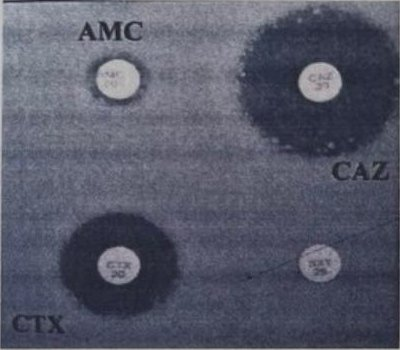

# Cas 1.36

SOURCE : *Université d’Alger – D.E.M.S. de Microbiologie, session janvier 2020*

### EXERCICE N°1

Voici une partie de l’antibiogramme d’une souche de *Proteus mirabilis*. Quel(s) mécanisme(s) de résistance vous évoque cette image? Quel(s) test(s) complémentaire(s) phénotypique(s) proposez-vous pour confirmer?

#### CORRIGÉ SUGGÉRÉ · CAS 1.36

Proposition de réponse rédigée par l’auteur (le sujet ne comportait pas de corrigé type dactylographié).

L’image montre, pour *Proteus mirabilis* (entérobactérie du groupe 0, naturellement dépourvue de céphalosporinase chromosomique), une résistance à l’amoxicilline-acide clavulanique (AMC) avec des zones d’inhibition des céphalosporines de 3^e^ génération (CAZ, CTX) altérées au voisinage du disque d’AMC (synergie / «bouchon de champagne») : mécanisme évoqué : **bêta-lactamase à spectre étendu (BLSE)**, de type CTX-M ou TEM/SHV, acquise sur plasmide. Tests complémentaires : test de synergie entre disque d’AMC et disques de CTX, CAZ, ATM, CPO à 20–30 mm (augmentation de la zone d’inhibition vers l’AMC); disques combinés céphalosporine/céphalosporine + acide clavulanique (augmentation *≥*5 mm); CMI avec et sans clavulanate (test E-test BLSE); tests à la cloxacilline pour écarter une céphalosporinase plasmidique; identification par PCR et séquençage (*bla*CTX-M, *bla*TEM, *bla*SHV).
