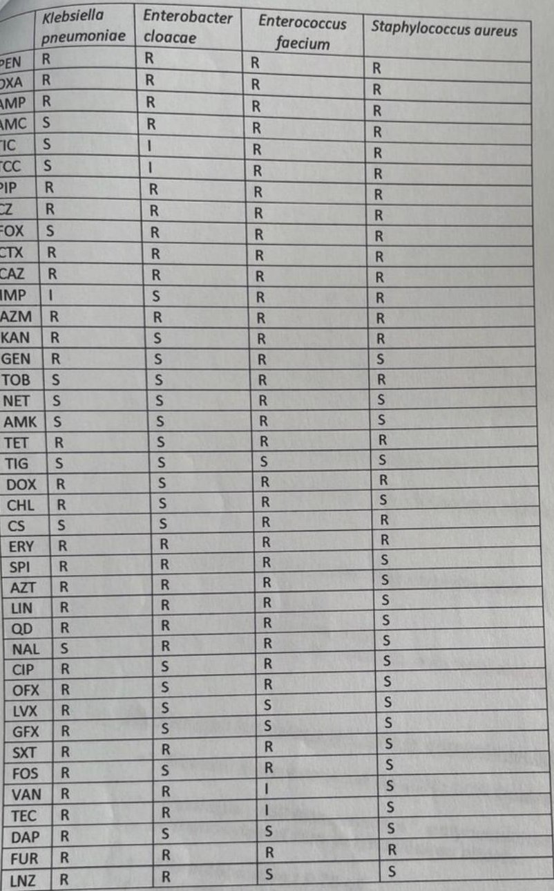

# Cas 1.38

SOURCE : *Université d’Alger – D.E.M.S. de Microbiologie, session janvier 2020*

### Cas clinique n° 1

Mme X, Aicha, 70 ans, hospitalisée en chirurgie cardiaque, est opérée le 7 février 2018 pour pontage tri-tronculaire. Les suites opératoires sont simples mais la patiente étant diabétique, sa glycémie reste difficile à équilibrer. 1 semaine plus tard soit le 18 février, la patiente signale une gêne sternale et des frissons; le pansement est souillé de quelques sécrétions jaunâtres émanant d’un point de suture mal cicatrisé. Un écouvillonnage de la plaie est adressé au laboratoire sur 2 écouvillons. L’examen direct montre de nombreux PN et la culture sur milieux usuels révèle une culture polymorphe faite de 4 types de colonies. **Question n°1 :** Que décidez-vous de faire? L’identification sur automate des 4 types de colonies retrouve :

- Colonies muqueuses : *Klebsiella pneumoniae*

- Colonies claires : *Enterobacter cloacae*

- Colonies petites sur GN catalase *−*: *Enterococcus faecium*

- Colonies blanches sur GN catalase+ : *Staphylococcus aureus* Vous effectuez les tests de sensibilité par techniques de diffusion sur gélose MH simple. Les disques d’antibiotiques sont contrôlés par des souches de référence. Les antibiogrammes obtenus sont lus et interprétés sur la base des tables de lecture du fascicule de standardisation 2014. Listing des antibiotiques testés pour chaque souche :

### Questions n°2 :

1) à partir de la liste globale des antibiotiques testés, restituer pour chaque germe, l’antibiogramme correspondant.

2) L’antibiogramme que vous avez restitué pour chaque germe est-il correct? Critiquez

#### CORRIGÉ · CAS 1.38

Corrigé type issu du document d’examen, reproduit tel quel.

*Extraits du corrigé-type (barème entre parenthèses) :* **Antibiogramme d’****Enterobacter cloacae** **– antibiotiques à rendre :**

- Céfalotine 30 *μ*g (0.25) : résistance naturelle

- Ceftazidime 30 *μ*g (0.25)

- Aztréonam 30 *μ*g (0.25)

- Amikacine 30 *μ*g (0.25)

- Chloramphénicol 30 *μ*g (0.25) **2- L’interprétation de l’antibiogramme est-elle correcte? Commentez**

- Erreur dans l’interprétation pour l’imipénème (résistance Intermédiaire) (0.25)

- Colistine ininterprétable, il faut faire des CMI (0.5)

- Fosfomycine 200 *μ*g pas de Fosfomycine 50 *μ*g (0.5)

- Acide nalidixique 30 *μ*g : sensible (0.25)

- Colonies dans le diamètre d’inhibition du Trimethoprime+sulfaméthoxazole (1.25/23.75) : retester le disque à partir des colonies dans le diamètre d’inhibition (0.25) **3- Quels sont le ou les mécanismes de résistances vis-à-vis des** *β***-Lactamines?**

- Céphalosporinase hyperproduite (0.25)

- imperméabilité (0.25)

Car c’est un *Enterobacter cloacae*. Mais possibilité de carbapénémase (0.25) et de BLSE (0.25). **5- Quels sont les tests complémentaires phénotypiques à faire en justifiant votre**

### réponse.

- Tests de double disque (0.25) sur boite de cloxacilline (0.25) (mise en évidence de BLSE)

- Céfepime – C4G doivent être testé (mise en évidence de CHP) (0.25)

- Test de Hodge (mise en évidence de carbapénémase) (0.25)

### 6- Quels sont les tests de confirmations de mécanisme

- Les tests immunochromatographique (carbapénémase) (0.25)

- NP carba (0.25)

- PCR (BLSE, Carbapénémase, imperméabilité, CHP) (0.5)

- Spectrométrie de Masse (0.5)
