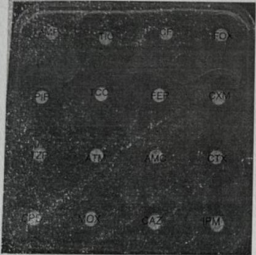
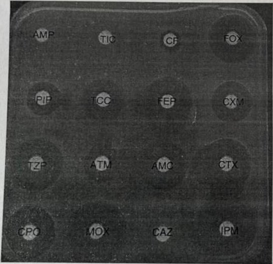
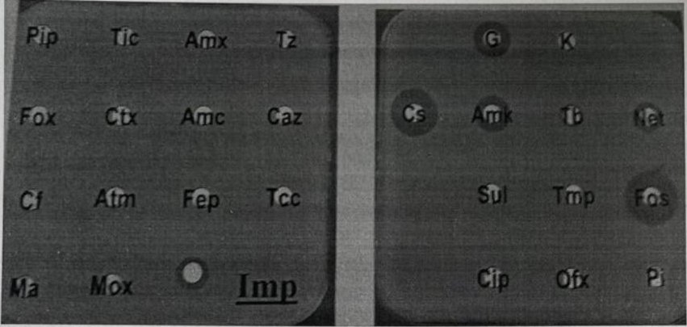

# Cas 1.39

SOURCE : *Université Saad Dahleb – Faculté de Médecine SOMAA, Concours National MCA, session janvier 2021* *– épreuves pratiques*

**Cas n°1 :** Vous isolez une souche de *Proteus mirabilis* avec l’antibiogramme suivant :

| Ampicilline | 6 mm | R |
|---|---|---|
| Amox+AC | 11 mm | R |
| Ticarcilline | 34 mm | S |
| Ticar+ AC | 33 | S |
| Pipéracilline | 25 | S |
| Pip+Tazo | 30 | S |
| Céfalotine | 6 | R |
| Céfoxitine | 22 | S |
| Céfuroxime | 29 | S |
| Céfotaxime | 28 | S |
| Ceftazidime | 28 | S |
| Céfépime | 32 | S |
| Aztréonam | 38 | S |
| Imipénème | 22 | S |

Quel est le mécanisme de résistance évoqué? justifiez :...

**Cas n°2 :** Vous identifiez par galerie API 20^E^ une souche d’*Enterobacter aerogenes* avec l’antibiogramme suivant :

| Ampicilline | 6 mm | R |
|---|---|---|
| Amox+AC | 22 mm | S |
| Ticarcilline | 6 mm | R |
| Ticar+ AC | 19 mm | I |
| Pipéracilline | 15 mm | I |
| Pip+Tazo | 24 mm | S |
| Céfalotine | 10 mm | R |
| Céfoxitine | 24 mm | S |
| Céfuroxime | 19 mm | I |
| Céfotaxime | 24 mm | S |
| Ceftazidime | 6 mm | R |
| Céfépime | 24 mm | S |
| Aztréonam | 17 mm | I |
| Imipénème | 29 mm | S |

Quel (s) est(sont) le ou les mécanismes de résistance évoqués? justifiez...

**Cas n°3 :** Vous isolez une souche de *Klebsiella pneumoniae* avec l’antibiogramme ci-dessous : CMI Imipenem = 32 *μ*g/ml CMI Gentamicine = 8 *μ*g/ml

Quel (s) est(sont) le ou les mécanismes de résistance aux bêtalactamines évoqués et quels sont les tests complémentaires que vous préconisez pour identifier ces mécanismes?

#### CORRIGÉ · CAS 1.39

Corrigé type issu du document d’examen, reproduit tel quel.

**Cas n°1.** Il s’agit d’une céphalosporinase acquise plasmidique (CMY-2). En effet, la résistance à AMP, AMC et céfalotine prouve qu’il y a céphalosporinase. *Proteus mirabilis* fait partie des entérobactéries du groupe 0 donc phénotype sauvage sensible, pas de céphalosporinase chromosomique. Conclusion : c’est la céphalosporinase plasmidique observée chez l’espèce *P. mirabilis*. **Cas n°2.** *Enterobacter aerogenes* BLSE+. Mécanismes : AmpC non inductible, BLSE+. **Cas n°3.** Mécanismes intriqués : hyperproduction de bêtalactamase chromosomique ou hyperproduction de CASE + BLSE et/ou carbapénèmase et/ou efflux multiples. Faire tests complémentaires :

- tester ERTA et témocilline

- disques combinés CTX/CTX CL, CAZ/CAZ CL, IMP/IMP EDTA sur MH et MH+CLOXA
