# Cas 1.51

SOURCE : *microbes-edu.com — Antibiotypes (lecture d’antibiogrammes)*

### Lecture d’antibiogrammes : Proteus (10 souches)

Pour chaque souche : *Pouvez-vous individualiser le comportement de cette souche vis-à-vis des* *antibiotiques étudiés?*

**AB - 1 :** Cette souche de *Proteus mirabilis* a été isolée à partir d’un prélèvement vaginal d’une femme enceinte quelques heures avant l’accouchement. Il n’y avait pas de flore associée.

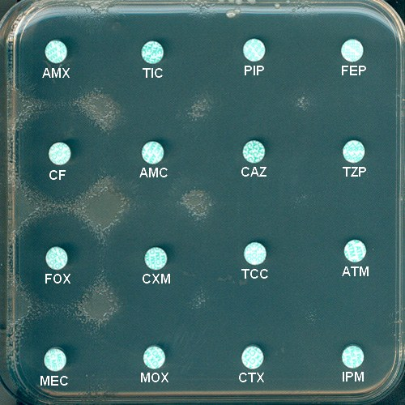

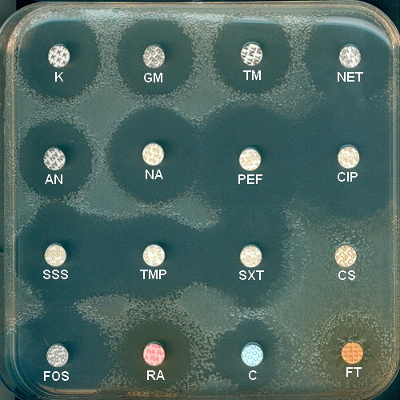

**AB - 2 :** Cette souche de *Proteus mirabilis* a été isolée à partir d’un ECBU chez une patiente présentant un tableau de pyélonéphrite. Les hémocultures en aérobiose et en anaérobiose étaient également positives avec le même germe.

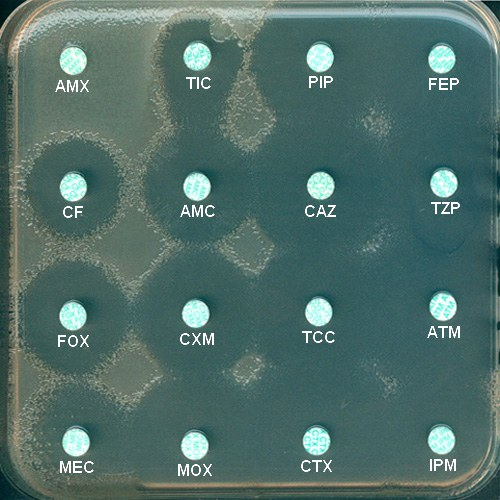

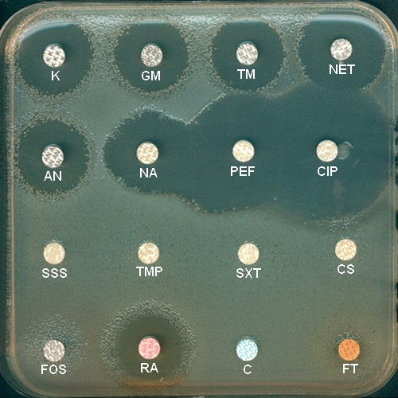

**AB - 3 :** Cette souche de *Proteus vulgaris* a été isolée dans un ECBU chez un patient de 68 ans, la veille de son opération d’un adénome de la prostate.

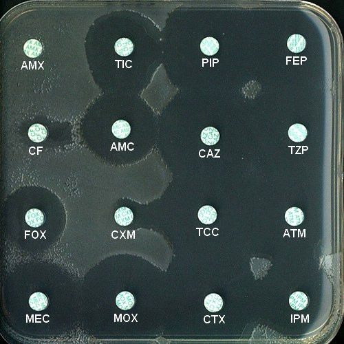

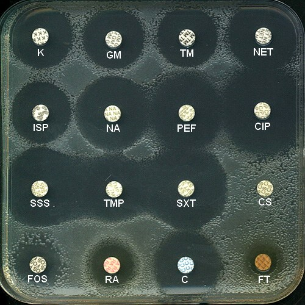

**AB - 4 :** Cette souche de *Proteus mirabilis* a été isolée dans un ECBU chez une patiente de 70 ans.

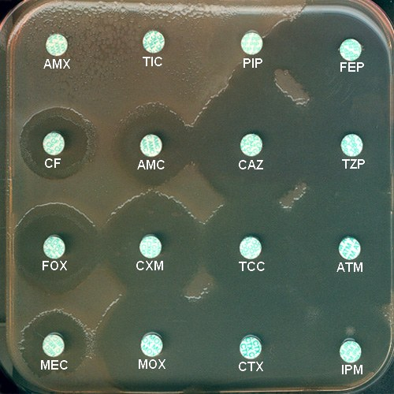

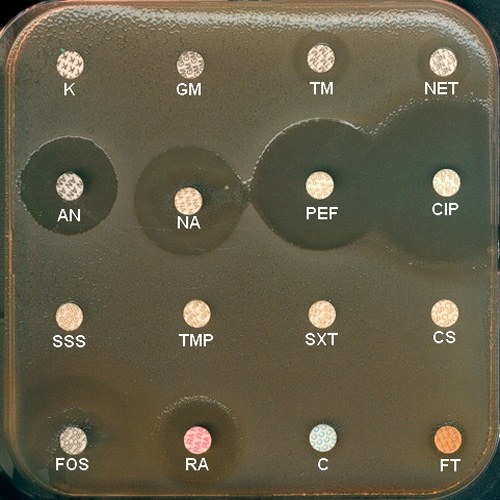

**AB - 5 :** Cette souche de *Proteus mirabilis* a été isolée dans un ECBU chez une patiente présentant une infection urinaire non compliquée.

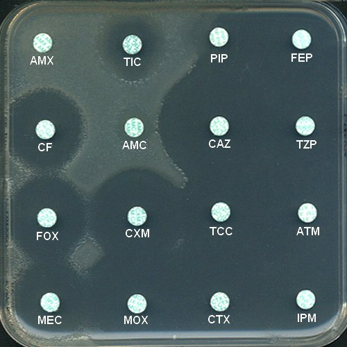

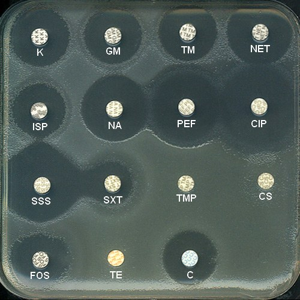

**AB - 6 :** Cette souche de *Proteus mirabilis* a été isolée à partir d’un ECBU chez une patiente de 26 ans ayant présenté des cystites récidivantes.

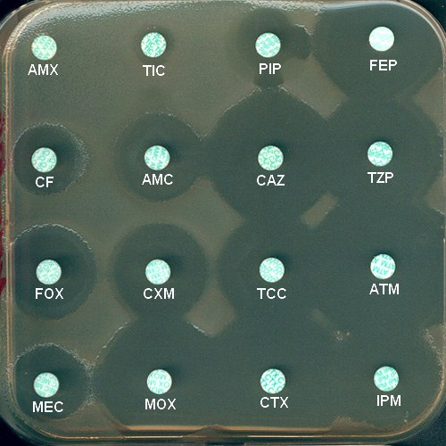

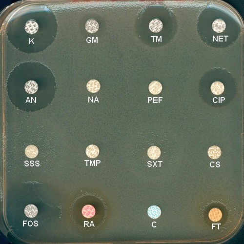

**AB - 7 :** Cette souche de *Proteus mirabilis* a été isolée dans un prélèvement vaginal en quantité abondante et en l’absence de flore associée, chez une patiente en suites de couches.

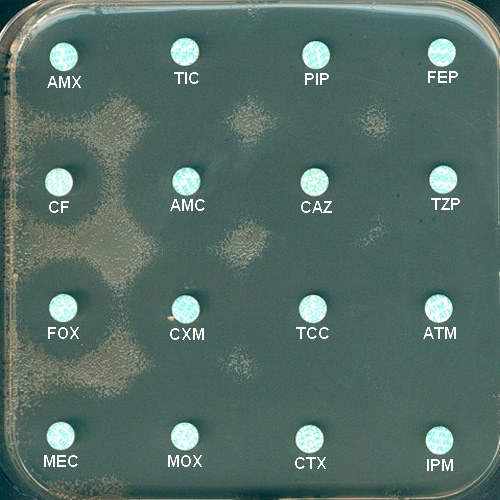

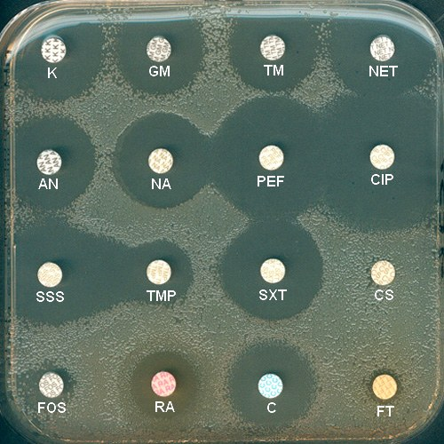

**AB - 8 :** Cette souche de *Proteus mirabilis* a été isolée dans les urines d’un patient âgé de 98 ans.

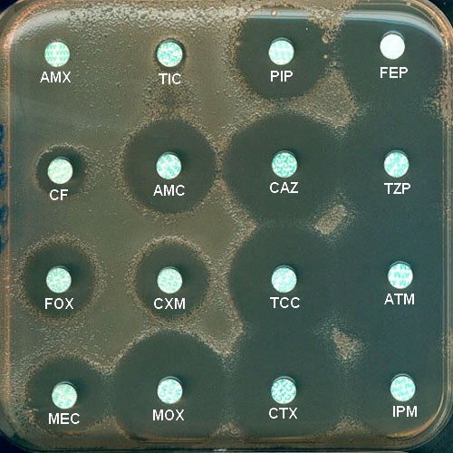

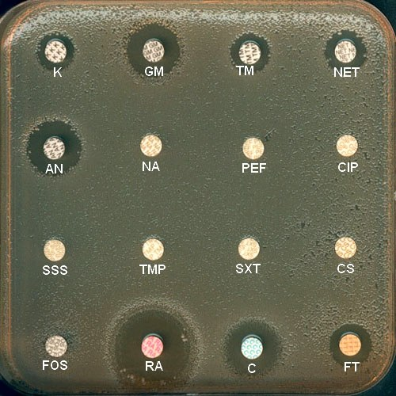

**AB - 9 :** Cette souche de *Proteus penneri* a été isolée dans un ECBU chez une enfant de 2 ans.

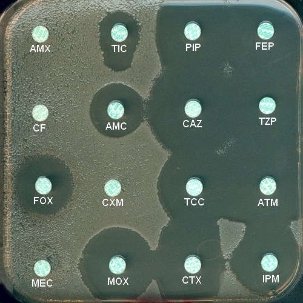

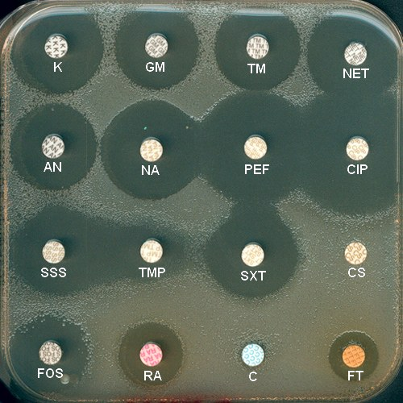

**AB - 10 :** Cette souche de *Proteus mirabilis* a été isolée à partir d’un prélèvement anal chez un patient transféré récemment d’un hôpital de moyen séjour vers une unité de réanimation pour une décompensation respiratoire.

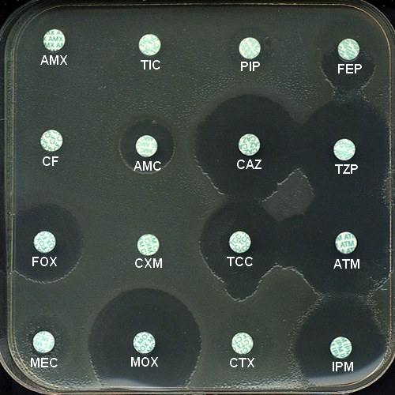

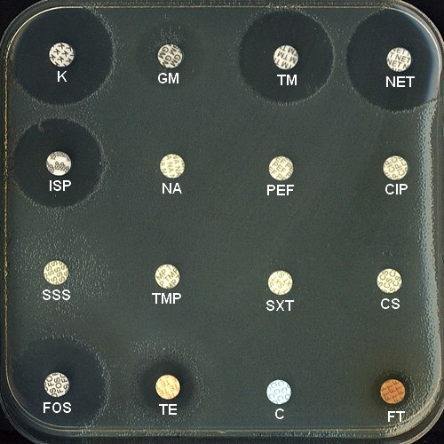

#### CORRIGÉ · CAS 1.51

Corrigé type issu du document d’examen, reproduit tel quel.

**AB - 1 : Phénotype sauvage** de *Proteus mirabilis*. On notera la présence d’un voile autour des disques de cotrimoxazole (SXT) et de chloramphénicol (C). La présence d’une croissance sous la forme d’un voile ne doit pas faire interpréter “souche résistante” à ces antibiotiques. Par ailleurs, on notera le niveau de résistance naturelle vis-à-vis des polypeptides cycliques (CS) et une résistance de bas niveau vis-à-vis des nitrofuranes (FT). Cette espèce se caractérise par une résistance naturelle vis-à-vis des tétracyclines (cf. autres QCM).

**AB - 2 :** Cette souche présente une résistance aux bêta-lactamines de type **pénicillinase**. On notera, en particulier, la bonne synergie entre l’amoxicilline (AMX) et son association avec l’acide clavulanique (AMC). La résistance vis-à-vis de la ticarcilline (TIC) est, pour cette espèce, d’expression, quelquefois, peu élevée, d’où une zone d’inhibition plus ou moins importante. Cette souche doit être interprétée résistante à la ticarcilline et intermédiaire à la pipéracilline (PIP). Pour les autres antibiotiques testés, on notera la résistance acquise vis-à-vis des sulfamides (SSS) et du triméthoprime (TMP). Par ailleurs, il y a résistance vis-à-vis de la fosfomycine (FOS), du chloramphénicol (C) et des nitrofuranes (FT).

**AB - 3 :** Le phénotype de cette souche de *Proteus vulgaris* vis-à-vis des bêta-lactamines est **un phénotype sauvage,** très caractéristique par sa production naturelle d’une céfuroximase, bêta-lactamase de la classe A : d’une part, synergie observée entre l’amoxicilline (AMX) et l’acide clavulanique (AMC), entre la céfalotine (CF) et l’acide clavulanique et d’autre part, entre l’acide clavulanique dans le disque de ticarcilline + inhibiteur (TCC) et le céfuroxime (CXM). On notera que les *Proteus* ont une sensibilité moindre pour l’imipénème (IPM). Pour les autres antibiotiques testés,on notera la résistance naturelle vis-à-vis des polymyxines telle la colimycine (CS), la sensibilité est peu importante vis-à-vis de la fosfomycine (FOS) et enfin une résistance acquise vis-à-vis de nitrofuranes (FT). Pour cette espèce, il est important de rappeler la présence d’un voile, en particulier observable sur la première boîte testée vis-à-vis des bêta-lactamines.

**AB - 4 :** Il s’agit d’une souche de *Proteus mirabilis* (noter la présence du voile et la pigmentation brune, la boîte ayant été photographiée après 48 heures d’incubation). Il s’agit d’un phénotype **pénicillinase de haut niveau** facilement identifiable, en particulier par la résistance vis-à-vis de la pipéracilline (PIP) et des synergies obtenues significatives entre l’amoxicilline (AMX), la ticarcilline (TIC) et la pipéracilline (PIP) et les inhibiteurs de *β*-lactamases (AMC, TCC, TZP). Pour les autres antibiotiques testés, on notera une résistance importante vis-à-vis des aminoglycosides : kanamycine (K), gentamicine (GM), tobramycine (TM) et nétilmicine (NET), la souche restant sensible à l’amikacine (AN). Il s’agit d’un phénotype KGMTMNET, lié à la production d’une enzyme d’inactivation, dénommée AAC(3)-II. On notera la fausse résistance phénotypique vis-à-vis des quinolones (NA) la boîte n’ayant pas été assez séchée avant de l’incuber. Il y a résistance acquise vis-à-vis des sulfamides (SSS), du triméthoprime (TMP), du chloramphénicol (C) et des nitrofuranes (FT). Enfin, il y a une fausse résistance (phénotypique) vis-à-vis de la fosfomycine (FOS) par envahissement en surface.

**AB - 5 :** Il s’agit d’une souche de *Proteus mirabilis* qui présente un phénotype de **résistance** **acquise aux bêta-lactamines de type TRI ou IRT.** En effet, il s’agit d’une pénicillinase

mutée peu sensible aux inhibiteurs de bêta-lactamases : absence de synergie significative entre l’amoxicilline (AMX) et son association avec l’acide clavulanique (AMC). Pour les autres antibiotiques testés, on notera la résistance acquise vis-à-vis du triméthoprime (TMP) et d’autre part l’absence très probable de synergie avec les sulfamides (SSS). En conséquence, cette souche est résistante au cotrimoxazole (SXT). Il y a résistance naturelle vis-à-vis des polypeptides (CS) et des tétracyclines (TE). Enfin, il convient d’indiquer que la sensibilité à l’association triméthoprime-sulfamides doit être interprétée en fonction de la présence ou absence d’une synergie entre les sulfamides (SSS) et le triméthoprime (TMP). Il y a donc une mauvaise disposition de ces disques dans cet exemple.

**AB - 6 :** Il s’agit d’un phénotype **pénicillinase**. On notera la petite zone d’inhibition autour de la ticarcilline (TIC). Par ailleurs, on notera une synergie inhabituelle entre le disque de pipéracilline (PIP) et les disques de céfépime (FEP) et de ceftazidime (CAZ). Cette synergie peut s’expliquer par la bonne affinité de ces céphalosporines par rapport à celle de la pipéracilline vis-à-vis de la bêta-lactamase qui est vraisemblablement une bêta-lactamase de type TEM. Pour les autres antibiotiques testés on notera la résistance vis-à-vis de la gentamicine (GM), la nétilmycine (NET) et la tobramycine (TM). Il s’agit probablement d’un phénotype AAC(2’). Il y a résistance acquise vis-à-vis des quinolones dont l’acide nalidixique (NA) et fluoroquinolones : péfloxacine (PEF) et ciprofloxacine (CIP). Il y a résistance acquise vis-à-vis des sulfamides (SSS) et du triméthoprime (TMP) ou encore du chloramphénicol (C) et des nitrofuranes (FT)(résistance naturelle). On notera la fausse résistance vis-à-vis de la fosfomycine (FOS) liée à un mauvais séchage de la boîte avant incubation à 37°C.

**AB - 7 :** Il s’agit d’un phénotype ayant probablement une modification de la perméabilité (déficience ou perte d’une porine), expliquant la diminution des diamètres autour des disques d’amoxicilline (AMX), céfalotine (CF) et céfoxitine (FOX). Par ailleurs, on notera la résistance de faible niveau vis-à-vis du triméthoprime (TMP) avec conservation de la synergie avec les sulfamides (SSS), celle vis-à-vis de la fosfomycine (FOS) et enfin celle, naturelle, vis-à-vis des polymyxines (CS) et des nitrofuranes (FT). La résistance naturelle vis-à-vis des tétracyclines n’a pas été montrée

**AB - 8 :** Il s’agit d’une souche de *Proteus mirabilis* ayant probablement deux mécanismes de résistance aux bêta-lactamines. D’une part, il y a une **pénicillinase** de type TEM, expliquant la résistance à l’amoxicilline (AMX), la ticarcilline (TIC) et les bonnes synergies avec l’acide clavulanique (AMC, TCC); la pipéracilline (PIP) doit être interprétée intérmédiaire. D’autre part, il y a une **imperméabilité** expliquant le diamètre diminué autour du disque de céfoxitine (FOX). Les deux mécanismes expliquent la mauvaise activité des céphalosporines de première génération (céfalotine, CF) et deuxième génération (céfuroxime, CXM). Pour les autres antibiotiques testés, on observe une résistance vis-à-vis des aminoglycosides, mais aussi des fluoroquinolones : résistance contact pour la ciprofloxacine (CIP). La multirésistance est notée vis-à-vis des sulfamides (SSS), du triméthoprime (TMP), de la fosfomycine (FOS), du chloramphénicol (C), des nitrofuranes (FT)(résistance naturelle) et enfin des polypeptides cycliques (CS)(résistance naturelle).

**AB - 9 :** Cette souche de *Proteus penneri* est hyperproductrice de sa bêta-lactamase chromosomique qui est une céfuroximase. Cette enzyme de classe A est sensible aux inhibiteurs de bêta-lactamase. L’hyperproduction enzymatique s’accompagne d’une sensibilité très diminuée vis-à-vis de la ticarcilline (TIC). L’excellente synergie obtenue entre la ticarcilline (TIC) et l’acide clavulanique (AMC) est la conséquence de cette

hyperproduction de céfuroximase qui n’entraîne pas de résistance vis-à-vis des céphalosporines de troisième génération tels le ceftazidime (CAZ) ou le céfotaxime (CTX). L’hyperproduction ou la dérépression de la production de bêta-lactamase n’exclue pas l’inductibilité clairement observée par l’xistance d’un antagonisme entre le disque d’imipénèmé (IPM) et les disques de céfotaxime (CTX) et aztréonam (ATM). La souche continue à être inductible tout en étant déréprimée (mutation d’un autre gène, *amp*D et non pas *amp*R). Pour les autres antibiotiques testés, il s’agit d’une souche présentant un phénotype sauvage : on notera la faible sensibilité par la méthode de diffusion pour le triméthoprime (TMP) mais une excellente synergie avec les sulfamides (SSS). Enfin, la résistance naturelle vis-à-vis des polymyxines (CS), des nitrofuranes (FT) montre l’intérêt taxonomique de les tester. Il y a seulement résistance acquise vis-à-vis du chloramphénicol (C). Par ailleurs, on sait que cette espèce est résistance naturellement à la tétracycline (TE).

**AB - 10 :** Cette souche de *Proteus mirabilis* est productrice d’une **BLSE** (*β*-lactamase à spectre élargi/étendu) : noter la résistance à haut niveau vis-à-vis de la ticarcilline (TIC), de la pipéracilline (PIP), de la céfalotine (CF) et du céfuroxime (CXM). Par ailleurs, il y a une synergie entre une céphalosporine de troisième génération, le céfotaxime (CTX), et le disque de ticarcilline associée à l’acide clavulanique (TCC). Une synergie est également observée entre le céfépime (FEP) et le disque de pipéracilline + tazobactam (TZP). Il s’agit d’un *Proteus*, donc observer le voile et la moindre sensibilité vis-à-vis de l’imipénème (IPM). Pour les autres antibiotiques étudiés, cette souche productrice d’une BLSE est résistante à divers antibiotiques : gentamicine (GM) par la présence d’une enzyme AAC(3)-I probablement, quinolones (NA) et fluoroquinolones dont la ciprofloxacine (CIP), sulfamides (SSS), triméthoprime (TMP) et chloramphénicol (C). La résistance vis-à-vis des nitrofuranes (FT) est naturelle. Enfin, la résistance naturelle aux tétracyclines (TE) peut quelquefois s’exprimer faiblement (petite zone d’inhibition autour du disque).
