# Cas 1.58

SOURCE : *CHU Oran — Séance de révision, juillet 2019 (correction : août 2019)*

**Efflux, staphylocoques, entérocoques et** **Pseudomonas aeruginosa**

*Diapositives de la séance reproduites telles quelles; répondre aux questions et compléter les cadres.*

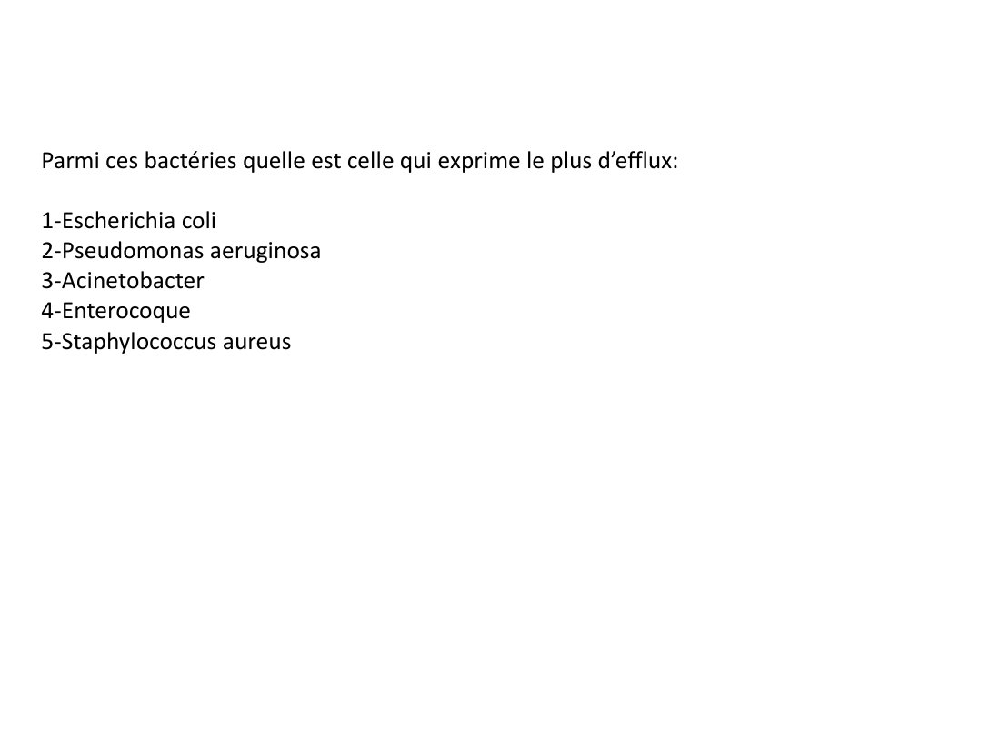

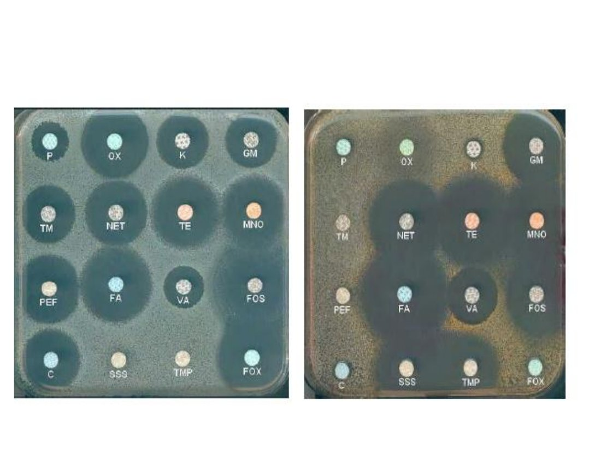

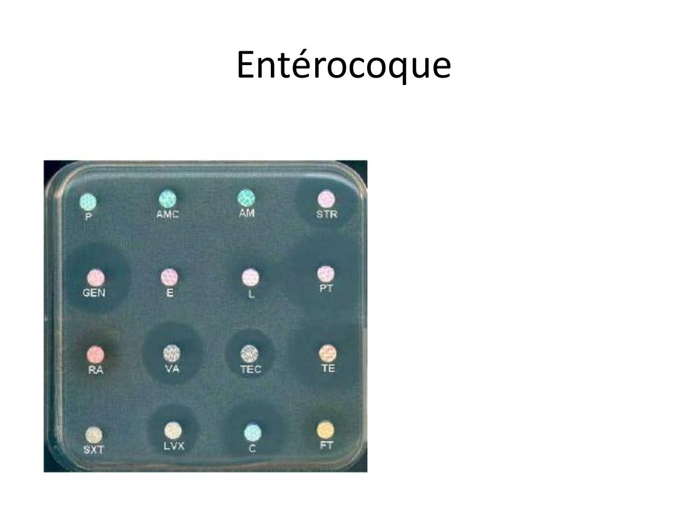

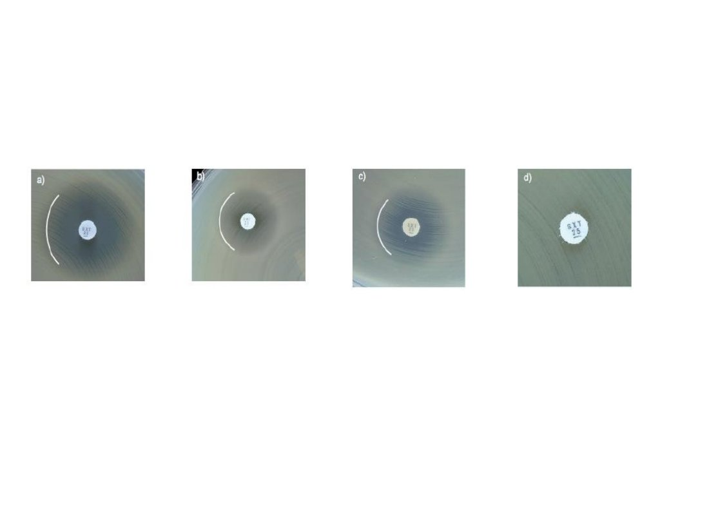

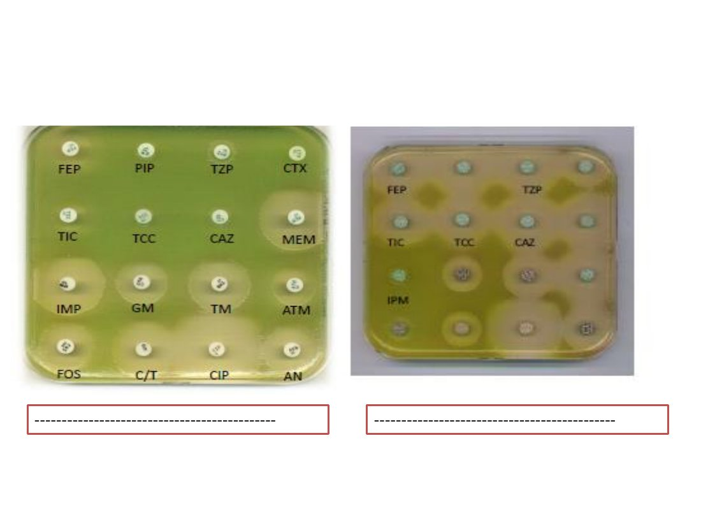

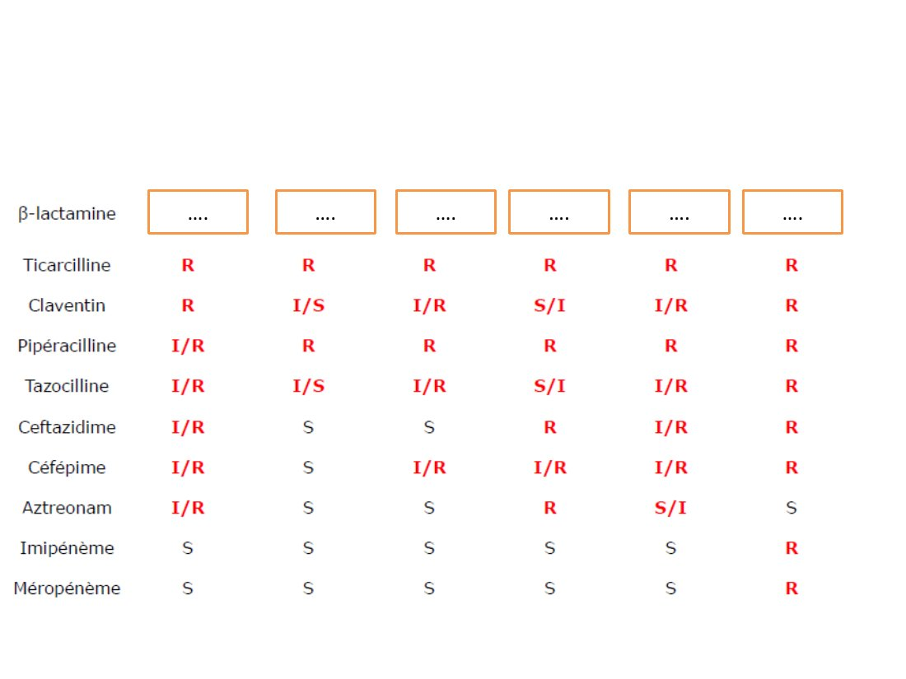

#### CORRIGÉ · CAS 1.58

Corrigé type issu du document d’examen, reproduit tel quel.

*Diapositives de correction de la séance (août 2019); les réponses figurent en rouge ou dans les cadres.*

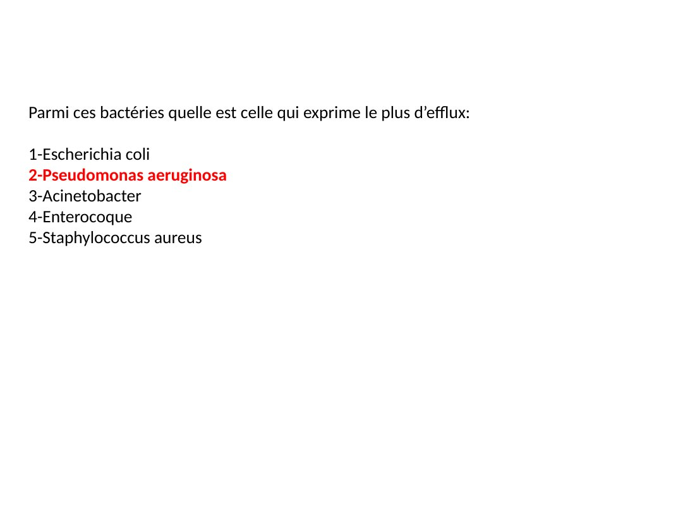

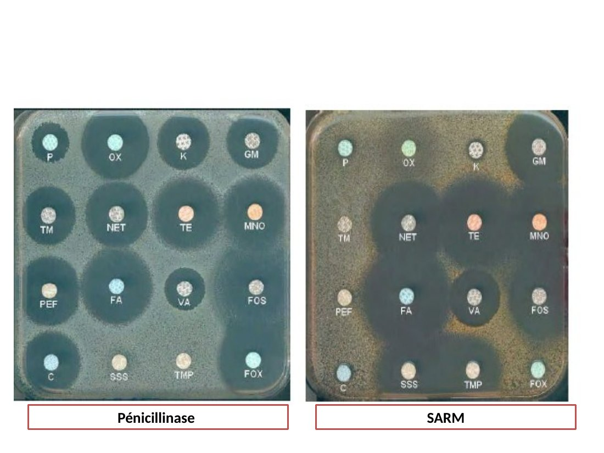

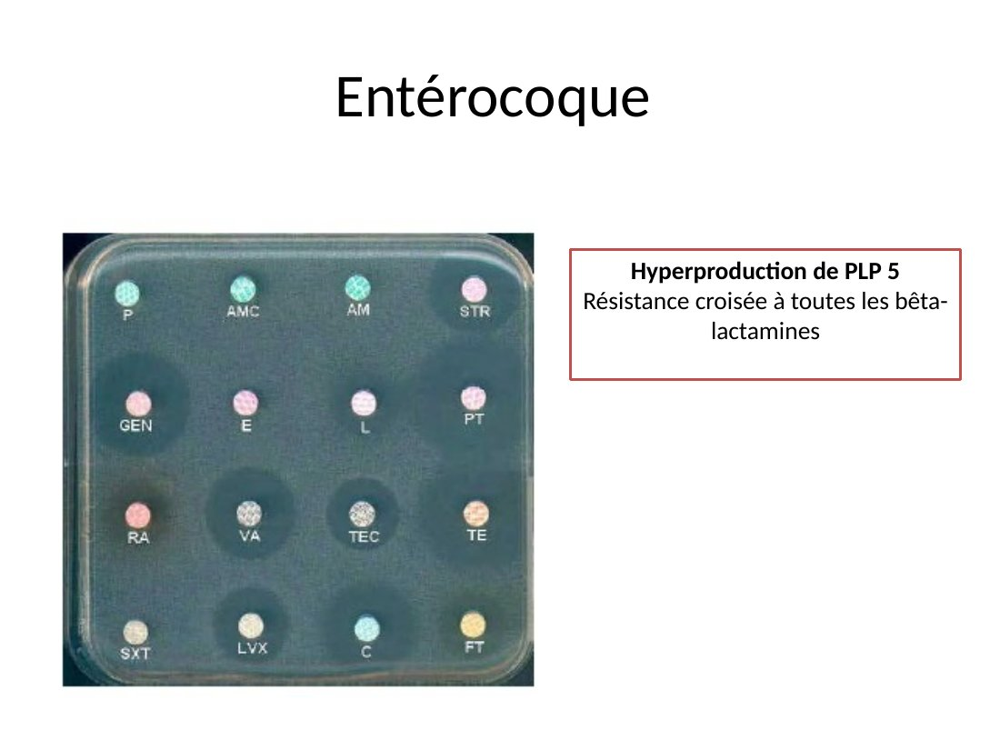

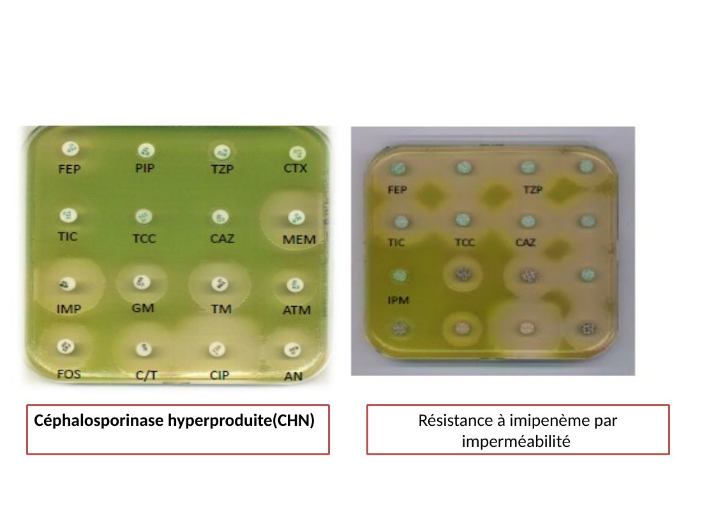

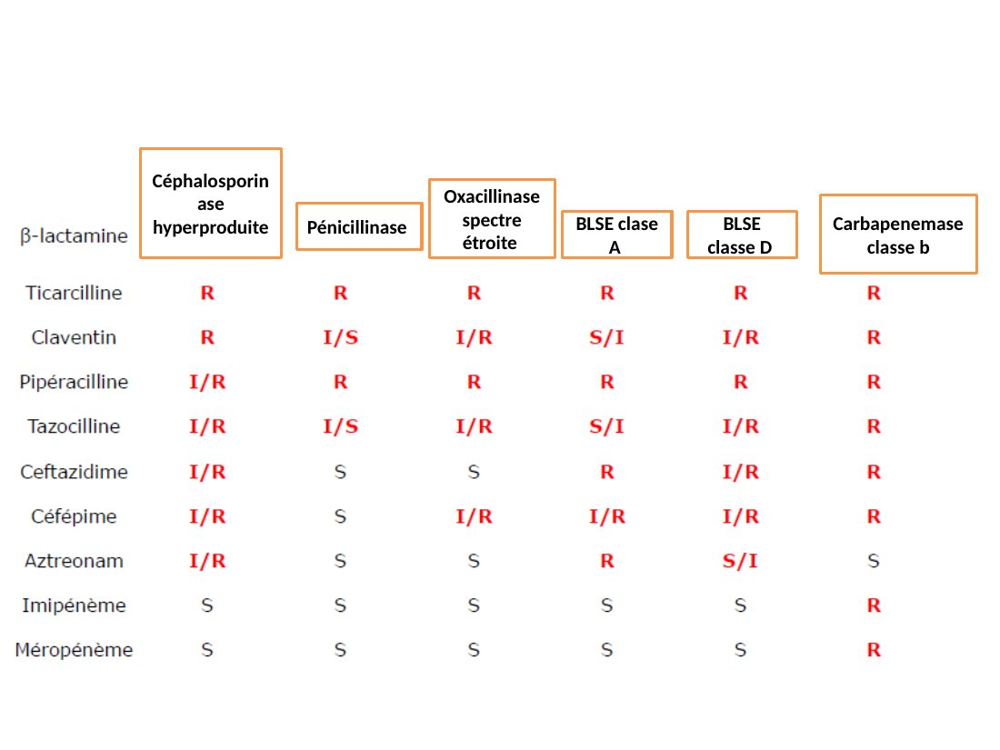

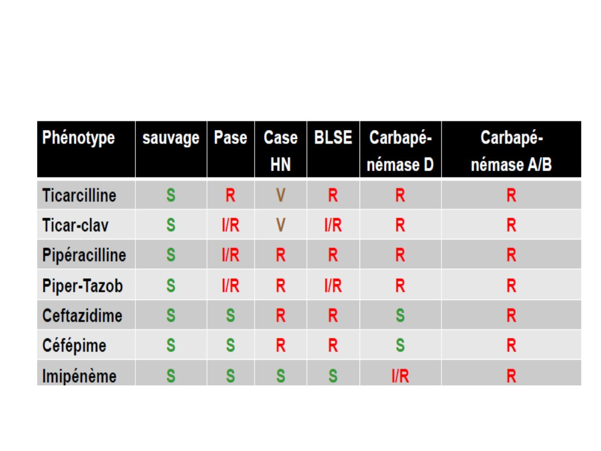
