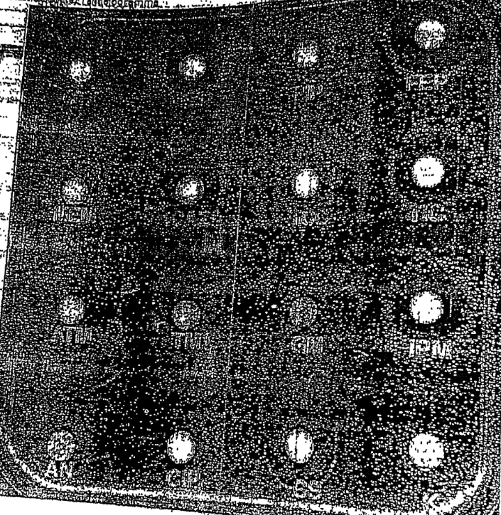

# Cas 1.100

Souche de *Pseudomonas aeruginosa* responsable d’une épidémie (20 patients) dans un service de réanimation. La présente souche est isolée d’une aspiration trachéale d’un patient intubé et ventilé de 56 ans. L’antibiogramme est réalisé sur gélose Mueller-Hinton simple (haut) et contenant 1000 mg/L de cloxacilline (bas) puis incubé 18 h à 37 °C. Interprétez l’antibiogramme.

#### CORRIGÉ SUGGÉRÉ · CAS 1.100

*Proposition de réponse rédigée par l’auteur (le sujet ne comportait pas de corrigé type dactylographié).*

**1.** Principe de la gélose avec cloxacilline.

- La cloxacilline inhibe la céphalosporinase chromosomique AmpC de *P. aeruginosa*. Une augmentation des diamètres sous cloxacilline traduit une **céphalosporinase hyperproduite**.
- Un diamètre inchangé traduit un autre mécanisme : **efflux**, **imperméabilité** (perte de la porine OprD) ou **β-lactamase acquise**.

**2.** Hypothèse retenue : **céphalosporinase hyperproduite associée à une imperméabilité** (hypothèse du phénotype à CHN + imperméabilité).

- Résistance aux pénicillines anti-pyocyaniques, à la ceftazidime et à l’aztréonam, partiellement restaurée par la cloxacilline.
- Résistance aux carbapénèmes par perte d’OprD.
- Souche épidémique : précautions complémentaires, typage et enquête.
