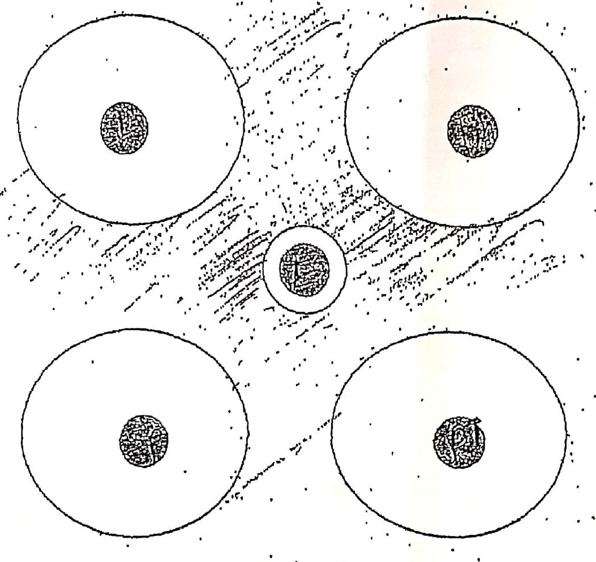

# Cas 1.100

1. Antibiogramme d’*Enterococcus faecium* :

| Antibiotique | Résultat |
|---|---|
| Amoxicilline | S |
| Oxacilline | R |
| Céfalotine | S |
| Érythromycine | S |
| Céfotaxime | R |
| Lincomycine | R |
| Pristinamycine | S |

Cette interprétation est juste ou fausse, pourquoi ?

2. Antibiogramme de pneumocoque :

| Antibiotique | Résultat |
|---|---|
| Érythromycine | R |
| Spiramycine | S |
| Lincomycine | S |
| Télithromycine | S |
| Pristinamycine | S |

NB : disque érythromycine au centre de la boîte, pas d’image d’antagonisme entre le disque d’érythromycine et les autres disques (voir figure).

Vous évoque quel mécanisme de résistance ?

#### CORRIGÉ SUGGÉRÉ · CAS 1.106

*Proposition de réponse rédigée par l’auteur (le sujet ne comportait pas de corrigé type dactylographié).*

**1.** **Fausse** : la céfalotine ne peut pas être **S**.

- *E. faecium* est naturellement résistant aux **céphalosporines** (faible affinité des PLP, notamment PLP5) : céfalotine, comme céfotaxime, doit être rendue **R**.
- Oxacilline R et céfotaxime R sont cohérents ; lincomycine R l’est aussi (résistance naturelle aux lincosamides).
- Pristinamycine S est cohérente chez *E. faecium* (contrairement à *E. faecalis*, naturellement résistant).

**2.** Mécanisme par **efflux actif** de type ***mef*(A)**.

- Résistance isolée à l’érythromycine (macrolides à 14 et 15 atomes), avec spiramycine (16 atomes), lincosamides, télithromycine et pristinamycine **sensibles** : phénotype **M**.
- L’absence d’image d’antagonisme (« dissociation ») entre l’érythromycine et les lincosamides écarte une résistance de type MLSB inductible (gène *erm*).
- Autres mécanismes écartés : méthylase *erm* (MLSB constitutive ou inductible) et mutation ribosomale.