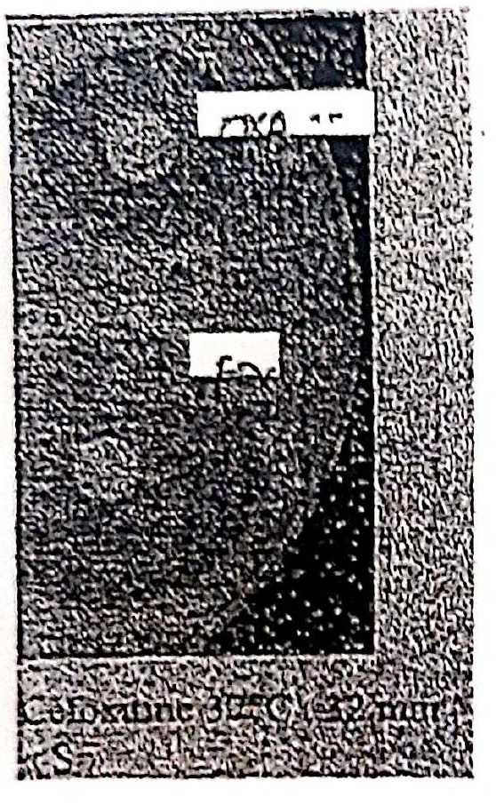

# Cas 1.104

SOURCE : *D.E.M.S. de microbiologie, Université d’Alger, Faculté de médecine — session janvier 2020, exercice n° 2*

Sur cet antibiogramme de *S. aureus*, vous notez une discordance du test de l’oxacilline et de la céfoxitine (voir image ci-dessus). Vous contrôlez par un nouveau test et le résultat est le même. À noter que le contrôle de qualité des disques a été fait.

1. À quel(s) mécanisme(s) pensez-vous ?
2. Quel(s) sont le(s) test(s) que vous pratiquez pour étayer ce (ces) mécanisme(s) ?

#### CORRIGÉ · CAS 1.110

*Corrigé type issu du document d’examen, reproduit tel quel.*

**1.** Gène *mecA* ou BORSA.

**2.** Recherche de la PLP 2a ou gène *mecA*. Si négatif, rechercher synergie OXA-acide clavulanique.