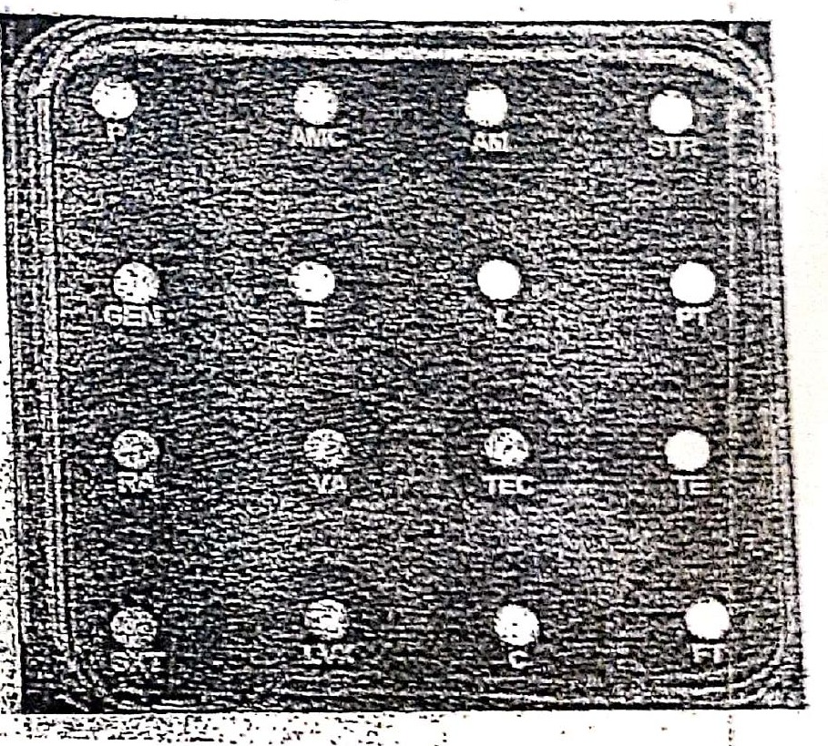
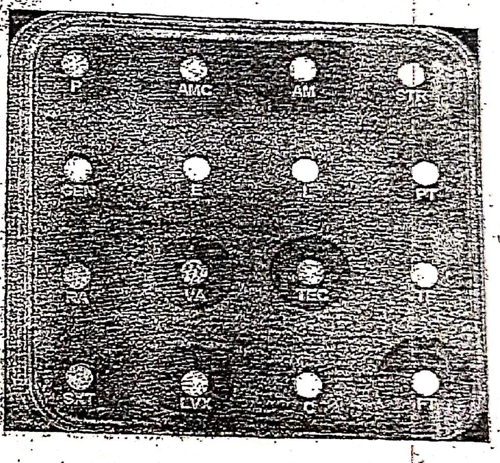

# Cas 1.108

SOURCE : *DEMS 2019*

Interpréter ces antibiogrammes :

1. *Enterococcus faecalis* :

2. *Enterococcus faecalis* :

#### CORRIGÉ SUGGÉRÉ · CAS 1.108

*Proposition de réponse rédigée par l’auteur (le sujet ne comportait pas de corrigé type dactylographié).*

Disques : P, AMC, AM, STR, GEN, E, L, PT, RA, VA, TEC, TE, SXT, LVX, C, FT.

**1.** *E. faecalis* n° 1.

- Aucune zone d’inhibition nette autour des disques : souche **multirésistante** (β-lactamines, aminosides, macrolides, tétracycline, cotrimoxazole, fluoroquinolone, chloramphénicol, nitrofurane).
- Les glycopeptides (VA, TEC) paraissent sans zone nette : possible **résistance aux glycopeptides** (ERV), à confirmer par CMI.
- Résistances naturelles attendues : lincosamides (L), pristinamycine (PT), céphalosporines, aminosides à bas niveau (GEN, STR).

**2.** *E. faecalis* n° 2.

- Zones d’inhibition nettes autour de **VA**, **TEC**, **LVX** et, plus discrète, de **FT** : souche **sensible aux glycopeptides**, à la lévofloxacine et à la nitrofurantoïne.
- Autres disques sans zone : résistance aux β-lactamines (P, AMC, AM), macrolides (E), lincosamides (L), PT, tétracycline, SXT, chloramphénicol, rifampicine.
- Interpréter selon les diamètres critiques CASFM/EUCAST ; la sensibilité à haut niveau des aminosides (GEN, STR) se recherche par disque fortement chargé.
