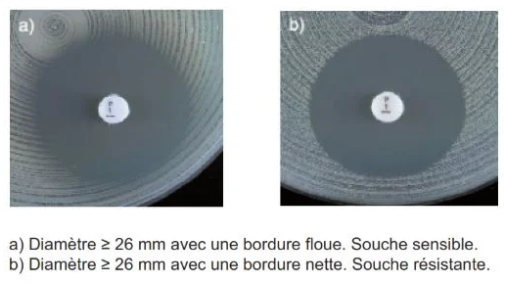

# Cas 1.109

Bêta-lactamines : que pensez-vous de cet antibiogramme de *S. aureus* ?

| Antibiotique | Résultat |
|---|---|
| Pénicilline G | R |
| Oxacilline | S |
| Amoxcilline | S |
| Amoxicilline + acide clavulanique | S |
| Oracilline | S |
| Céfazoline | S |

#### CORRIGÉ SUGGÉRÉ · CAS 1.109

*Proposition de réponse rédigée par l’auteur (le sujet ne comportait pas de corrigé type dactylographié).*

**1.** Antibiogramme **discordant**, à interpréter avec la lecture de la bordure de la zone d’inhibition de la pénicilline G.

- La pénicilline G (R) et l’amoxicilline (S) sont hydrolysées de la même façon par une pénicillinase : une souche R à la pénicilline G est **R à l’amoxicilline**. Le résultat « amoxicilline S » est à corriger.
- Phénotype attendu d’un *S. aureus* **producteur de pénicillinase** : pénicilline G R, amoxicilline R, mais **association amoxicilline-acide clavulanique S, oxacilline S, céfazoline S** (molécules stables ou protégées).
- Figure : un diamètre ⩾ 26 mm pour le disque de pénicilline G n’exclut pas une pénicillinase. La **bordure** tranche : **floue** (« plage ») ⇒ souche sensible ; **nette** (« falaise ») ⇒ souche **productrice de pénicillinase**, à rendre R.
- Conclusion : *S. aureus* **sensible à la méticilline (SASM)** producteur de pénicillinase. L’oxacilline S est à confirmer par le disque de **céfoxitine** (CASFM/EUCAST : diamètre ⩾ 22 mm ⇒ sensible).
