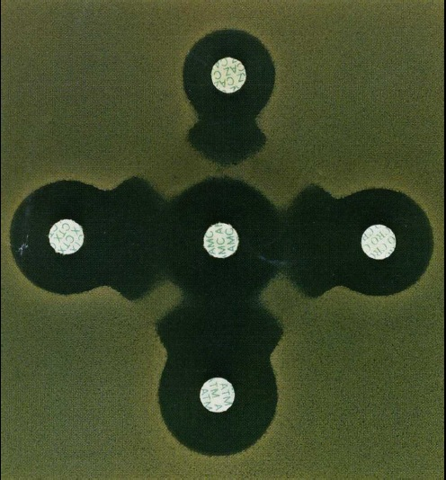

# Cas 1.113

*E. coli*

Cette souche :

1. Produit une BLSE
2. Ne produit pas une BLSE
3. Autres tests nécessaires
4. Ne sait pas

*1 réponse possible*

#### CORRIGÉ SUGGÉRÉ · CAS 1.113

*Proposition de réponse rédigée par l’auteur (le sujet ne comportait pas de corrigé type dactylographié).*

**1.** Réponse **1** : la souche **produit une BLSE**.

- Le disque central (amoxicilline-acide clavulanique, d’après la disposition classique) est entouré de quatre disques périphériques (céphalosporines de 3^e^ génération, céphalosporine de 4^e^ génération et aztréonam, d’après la disposition classique).
- Les **quatre** zones d’inhibition périphériques sont déformées en direction du disque central : **image de synergie en « bouchon de champagne »**. L’acide clavulanique inhibe l’enzyme et restaure l’activité des β-lactamines voisines.
- Cette image est caractéristique d’une **β-lactamase à spectre étendu (BLSE)**. Elle est évidente ici ; il n’y a pas lieu de recourir à un autre test.
- Conséquence : carbapénème en traitement des infections graves.
