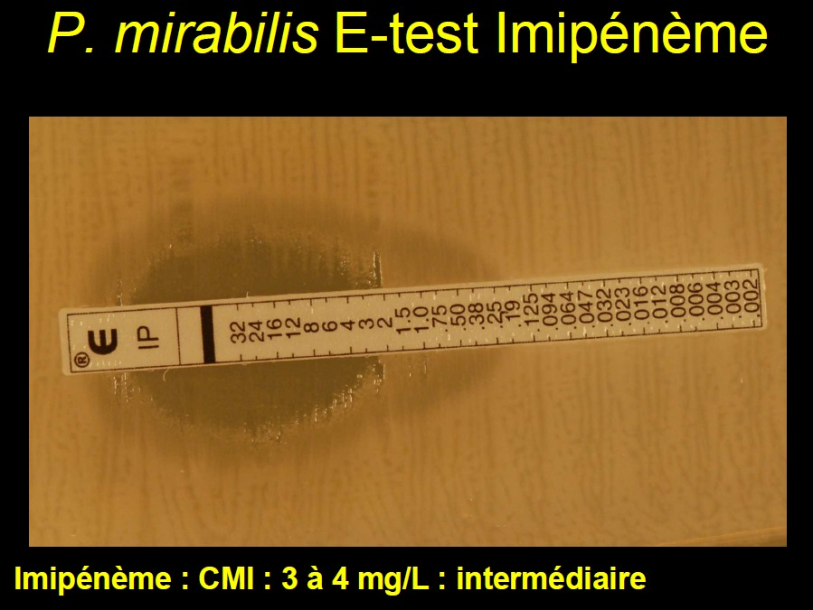
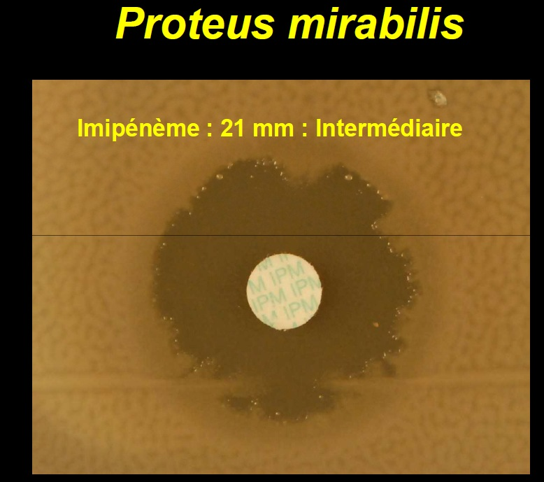

# Cas 1.114

*Proteus mirabilis*

Vous faites ?

1. Un test de Hodge carbapénèmes
2. Un antibiogramme sur cloxacilline
3. Un test imipénème + EDTA
4. Vous testez le méropénème
5. Vous testez l’ertapénème
6. Je ne sais pas

*1 seule réponse attendue*

#### CORRIGÉ SUGGÉRÉ · CAS 1.114

*Proposition de réponse rédigée par l’auteur (le sujet ne comportait pas de corrigé type dactylographié).*

**1.** Réponse **5** : tester l’**ertapénème**.

- *P. mirabilis* a une **sensibilité naturellement diminuée à l’imipénème** (affinité réduite pour les PLP) : un diamètre de 21 mm (I) et une CMI de 3 à 4 mg/L sont fréquents **sans carbapénémase**. L’imipénème est un mauvais marqueur chez *Proteus*.
- L’**ertapénème** est le carbapénème le plus sensible pour détecter une carbapénémase chez les entérobactéries (critères de dépistage CASFM/EUCAST). S’il est sensible, une carbapénémase est exclue.
- Test de Hodge : peu spécifique, abandonné. Cloxacilline : inhibiteur de céphalosporinase de classe C, sans objet chez *P. mirabilis* (pas d’AmpC chromosomique). EDTA : recherche d’une métallo-β-lactamase, qui n’a pas de raison d’être faite avant la preuve d’une carbapénémase.
