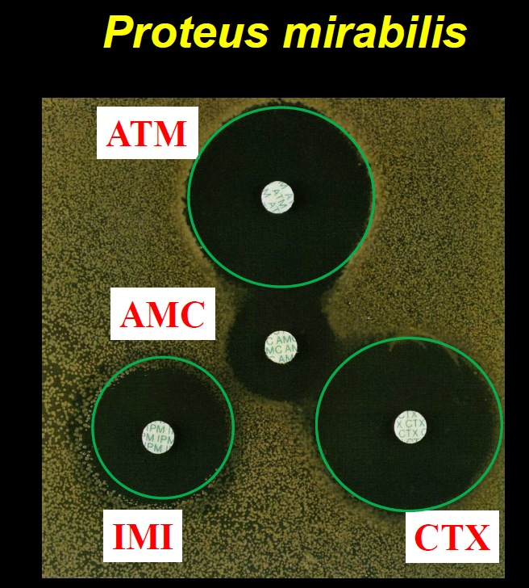

# Cas 1.115

*Proteus mirabilis*

1. Ce *Proteus mirabilis* produit une BLSE
2. Ce *Proteus mirabilis* produit une céphalosporinase
3. Ce *Proteus mirabilis* produit une carbapénémase
4. Ce *Proteus mirabilis* produit une pénicillinase
5. Aucune conclusion : autre(s) test(s) nécessaire(s)
6. Ne sait pas

*1 réponse attendue*

#### CORRIGÉ SUGGÉRÉ · CAS 1.115

*Proposition de réponse rédigée par l’auteur (le sujet ne comportait pas de corrigé type dactylographié).*

**1.** Réponse **5** : aucune conclusion possible, un autre test est nécessaire.

- **BLSE exclue** : les zones de l’aztréonam (ATM) et du céfotaxime (CTX) sont régulières et rondes ; il n’y a **pas de déformation** vers le disque d’amoxicilline-acide clavulanique (AMC), donc pas de bouchon de champagne.
- **Céphalosporinase exclue** : *P. mirabilis* n’en possède pas de chromosomique ; les zones ATM et CTX sont larges.
- **Carbapénémase non retenue** : la zone de l’imipénème (IMI) est nette ; son diamètre plus petit est habituel chez *Proteus* (sensibilité naturellement diminuée).
- **Pénicillinase** : non démontrable sur ce montage, qui ne comporte pas de disque d’amoxicilline ni de ticarcilline.
- Seul un test complémentaire, avec les disques d’aminopénicilline et de carboxypénicilline, permettrait de conclure.
