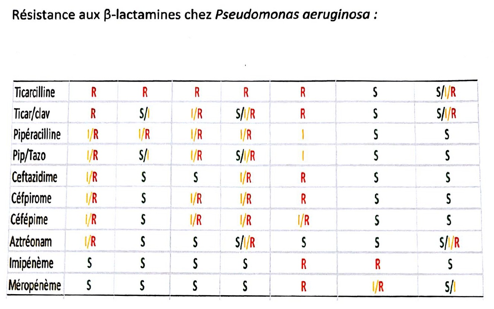

# Cas 1.117

Résistance aux β-lactamines chez *Pseudomonas aeruginosa* :

|  |  |  |  |  |  |  |  |
|---|---|---|---|---|---|---|---|
| Ticarcilline | R | R | R | R | R | S | S/I/R |
| Ticar/clav | R | S/I | I/R | S/I/R | R | S | S/I/R |
| Pipéracilline | I/R | I/R | I/R | I/R | I | S | S |
| Pip/Tazo | I/R | S/I | I/R | S/I/R | I | S | S |
| Ceftazidime | I/R | S | S | I/R | R | S | S |
| Cefpirome | I/R | S | I/R | I/R | R | S | S |
| Céfépime | I/R | S | I/R | I/R | I/R | S | S |
| Aztréonam | I/R | S | S | S/I/R | S | S | S/I/R |
| Imipénème | S | S | S | S | R | R | S |
| Méropénème | S | S | S | S | R | I/R | S/I |

#### CORRIGÉ SUGGÉRÉ · CAS 1.117

*Proposition de réponse rédigée par l’auteur (le sujet ne comportait pas de corrigé type dactylographié).*

Les colonnes ne portent pas de titre dans le sujet ; elles sont numérotées de gauche à droite.

**1.** Colonne 1 : **efflux actif hyperproduit (MexAB-OprM)**.

- Toutes les β-lactamines sont I/R (y compris ticarcilline-clavulanate et aztréonam), **carbapénèmes S**. L’acide clavulanique ne restaure rien.

**2.** Colonne 2 : **pénicillinase acquise** (type PSE/CARB).

- Ticarcilline R, mais ticarcilline-clavulanate S/I (**effet de l’inhibiteur**). Pipéracilline I/R, pipéracilline-tazobactam S/I. Céphalosporines, aztréonam et carbapénèmes S.

**3.** Colonne 3 : profil évoquant un **efflux de type MexXY-OprM**, éventuellement associé à une pénicillinase.

- Ceftazidime et aztréonam S, mais **céfépime et cefpirome I/R** : MexXY touche les C4G et pas la ceftazidime. Pénicillines et associations I/R.

**4.** Colonne 4 : **céphalosporinase hyperproduite** (AmpC déréprimée).

- Ticarcilline R, ticarcilline-clavulanate non restaurée, ceftazidime, cefpirome et céfépime I/R, pipéracilline-tazobactam et aztréonam variables, carbapénèmes S.

**5.** Colonne 5 : **carbapénémase de type métallo-β-lactamase (VIM, IMP, NDM)**.

- **Imipénème et méropénème R**, avec **aztréonam conservé** (S) ; ni le clavulanate ni le tazobactam n’agissent. Confirmation : synergie avec l’EDTA ou l’acide dipicolinique.

**6.** Colonne 6 : **imperméabilité par perte de la porine OprD**.

- **Imipénème R**, méropénème I/R (moins touché), toutes les autres β-lactamines S.

**7.** Colonne 7 : **phénotype sauvage**.

- Pipéracilline, céphalosporines et carbapénèmes S ; ticarcilline et aztréonam à sensibilité variable (résistance naturelle de bas niveau).
