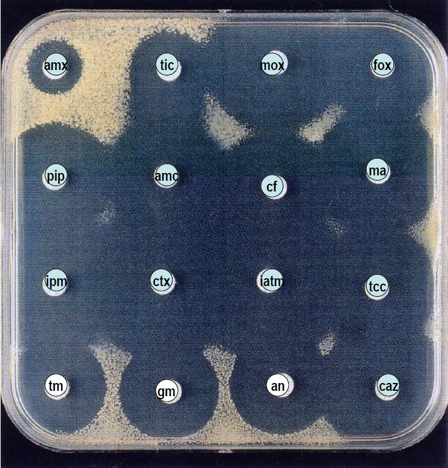

# Cas 1.119

*Klebsiella pneumoniae* : phénotype ?

#### CORRIGÉ SUGGÉRÉ · CAS 1.119

*Proposition de réponse rédigée par l’auteur (le sujet ne comportait pas de corrigé type dactylographié).*

**1.** Souche **sensible aux β-lactamines**, sans mécanisme acquis.

- Zones larges, confluentes, pour les céphalosporines, la céfoxitine (FOX), les carbapénèmes et les aminosides : pas de BLSE (aucune déformation, aucune synergie), pas de céphalosporinase hyperproduite, pas de carbapénémase.
- Seule l’**amoxicilline** (AMX) a une zone réduite.
- Remarque : une *K. pneumoniae* sauvage produit une **pénicillinase chromosomique (SHV-1)**, donc AMX **et** ticarcilline (TIC) R. Une ticarcilline avec une zone large est atypique : vérifier l’identification et la pureté de la souche.
