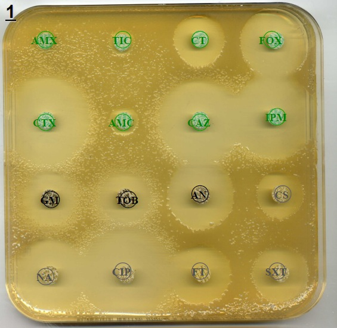
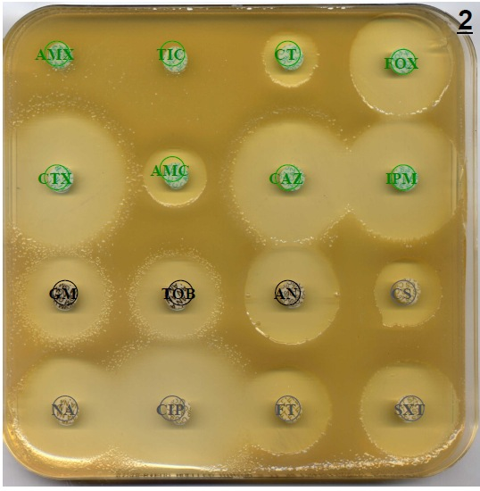

# Cas 1.120

Interprétez

Souche n° 1. Il s’agit :

1. Pénicillinase à large spectre de **b**as **n**iveau
2. Pénicillinase TRI
3. Pénicillinase à large spectre de **h**aut **n**iveau
4. Imperméabilité

Souche n° 2. Il s’agit :

5. Pénicillinase à large spectre de **b**as **n**iveau
6. Pénicillinase TRI
7. Pénicillinase à large spectre de **h**aut **n**iveau
8. Imperméabilité

#### CORRIGÉ SUGGÉRÉ · CAS 1.120

*Proposition de réponse rédigée par l’auteur (le sujet ne comportait pas de corrigé type dactylographié).*

Les diamètres ne sont pas mesurables sur la photographie ; les lectures ci-dessous reposent sur l’aspect des zones.

**1.** Souche n° 1 : réponse **2**, **pénicillinase résistante aux inhibiteurs (TRI)**.

- Amoxicilline et ticarcilline : aucune zone.
- Amoxicilline-acide clavulanique : **aucune zone** (l’inhibiteur ne restaure pas l’activité).
- Céfalotine : zone nette, **céphalosporine de 1^re^ génération peu touchée** ; céfoxitine, céfotaxime, ceftazidime et imipénème S.
- Ce trio (AMC R, céfalotine conservée, C3G S) évoque une **TEM résistante aux inhibiteurs**.

**2.** Souche n° 2 : réponse **7**, **pénicillinase à large spectre de haut niveau**.

- Amoxicilline et ticarcilline : aucune zone.
- Amoxicilline-acide clavulanique : zone **réduite** ; céfalotine : zone **très réduite** (hyperproduction de l’enzyme qui touche l’association et la C1G).
- Céfoxitine, C3G, aztréonam et imipénème S : pas de BLSE.
- L’imperméabilité (réponses 4 et 8) donnerait des zones réduites pour plusieurs classes, ce qui n’est pas le cas.
