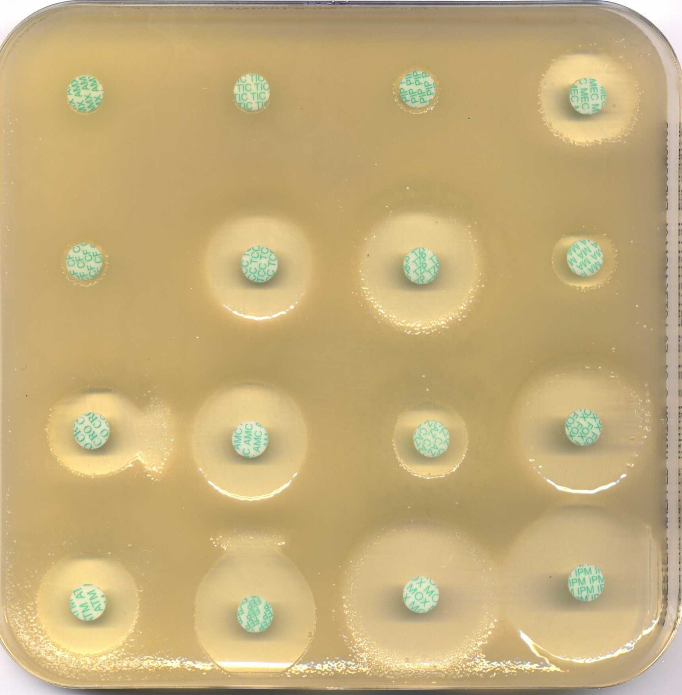

# Cas 1.121

Phénotype ?

#### CORRIGÉ SUGGÉRÉ · CAS 1.121

*Proposition de réponse rédigée par l’auteur (le sujet ne comportait pas de corrigé type dactylographié).*

Les disques ne sont pas étiquetés de façon lisible ; la lecture suppose la disposition des plaques des cas voisins (AMX, TIC, PIP, FEP / CF, AMC, CAZ, PTZ / FOX, CXM, TCC, ATM / MEC, MOX, CTX, IPM).

**1.** **Pénicillinase de haut niveau** (hyperproduction de type TEM-1/SHV-1).

- Amoxicilline, ticarcilline, pipéracilline et céfalotine : **aucune zone**.
- Amoxicilline-acide clavulanique, ticarcilline-clavulanate et pipéracilline-tazobactam : **zones réduites** (l’inhibiteur est débordé).
- Céfoxitine, céphalosporines de 3^e^ génération, aztréonam et carbapénèmes : zones larges, **pas de synergie** (pas de BLSE), pas de carbapénémase.
