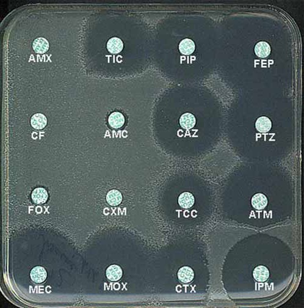

# Cas 1.122

Phénotype ?

#### CORRIGÉ SUGGÉRÉ · CAS 1.122

*Proposition de réponse rédigée par l’auteur (le sujet ne comportait pas de corrigé type dactylographié).*

**1.** **Céphalosporinase chromosomique naturelle de bas niveau** (phénotype sauvage des entérobactéries du groupe 3).

- **R** : amoxicilline (AMX), céfalotine (CF), céfuroxime (CXM), **céfoxitine (FOX, zone très réduite)** et amoxicilline-acide clavulanique (AMC, zone très réduite).
- **S** : ticarcilline, pipéracilline, associations avec inhibiteurs, C3G (CAZ, CTX), céfépime, aztréonam, carbapénèmes.
- Ce profil est celui d’*Enterobacter*, *Citrobacter freundii*, *Serratia*, *Morganella*, *Providencia*, *Hafnia*. La résistance à la céfoxitine signe la **céphalosporinase** ; les C3G restent actives car l’enzyme est produite à bas niveau.
- Il n’y a pas de synergie : pas de BLSE.
