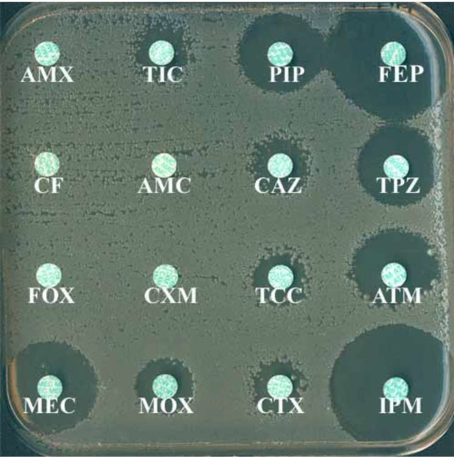

# Cas 1.123

Phénotype ?

#### CORRIGÉ SUGGÉRÉ · CAS 1.123

*Proposition de réponse rédigée par l’auteur (le sujet ne comportait pas de corrigé type dactylographié).*

**1.** **Céphalosporinase hyperproduite de haut niveau** (AmpC déréprimée).

- Aucune zone pour amoxicilline, ticarcilline, céfalotine, amoxicilline-acide clavulanique, **céfoxitine** et céfuroxime.
- Zones **réduites** pour les C3G (ceftazidime, céfotaxime), pipéracilline, ticarcilline-clavulanate, pipéracilline-tazobactam et aztréonam.
- **Céfépime** (C4G, stable vis-à-vis d’AmpC) et **carbapénèmes** conservés.
- Pas d’image de synergie : pas de BLSE. L’acide clavulanique n’inhibe pas la céphalosporinase.
- Confirmation : antibiogramme sur gélose additionnée de **cloxacilline**, qui restaure les zones des C3G.
