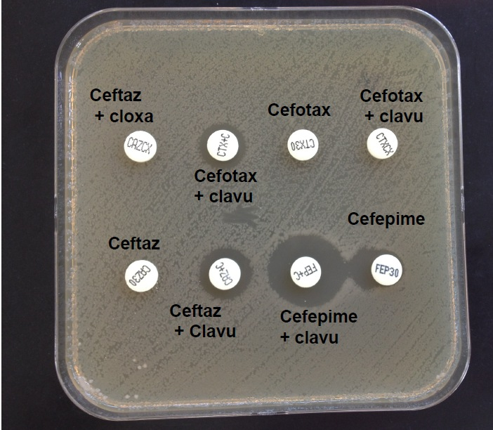

# Cas 1.124

Un patient développe une pneumopathie nosocomiale et on isole dans son LBA une *Klebsiella pneumoniae* dont l’antibiogramme est le suivant :

| Antibiotique | Résultat |
|---|---|
| Amoxicilline | R |
| Amoxicilline + acide clavulanique | R |
| Ticarcilline | R |
| Ticarcilline + acide clavulanique | R |
| Pipéracilline | R |
| Pipéracilline + tazobactam | S |
| Céfalotine | R |
| Céfoxitine | S |
| Ceftazidime | R |
| Céfotaxime | S |
| Imipénème | S |

**Question** : Le céfotaxime doit être interprété ?

1. S
2. I
3. R

Il s’agit :

1. d’une BLSE
2. d’une céphalosporinase
3. d’une imperméabilité

#### CORRIGÉ SUGGÉRÉ · CAS 1.124

*Proposition de réponse rédigée par l’auteur (le sujet ne comportait pas de corrigé type dactylographié).*

**1.** Interprétation du céfotaxime : réponse **3, R**.

- Profil : ceftazidime R, céfotaxime S (apparent), céfoxitine S, pipéracilline-tazobactam S, imipénème S, amoxicilline-acide clavulanique R : **BLSE** de type TEM/SHV à spectre « ceftazidimase ». La céfoxitine S écarte une céphalosporinase.
- Lecture interprétative classique : chez une souche productrice de BLSE, **toutes les C3G, C4G et l’aztréonam sont à rendre R**, même si le diamètre ou la CMI paraissent S.

!!! warning "Attention"
    Les recommandations actuelles du CASFM/EUCAST ne demandent plus la lecture interprétative systématique, mais déconseillent l’emploi des C3G en traitement d’une souche BLSE.

**2.** Mécanisme (boîte de synergie) : réponse **1, BLSE**.

- Ceftazidime et céfotaxime : pas de zone. Avec l’**acide clavulanique**, une zone apparaît pour la ceftazidime et le céfépime, avec **synergie** (image en bouchon de champagne autour de céfépime + clavulanate).
- Ceftazidime + **cloxacilline** : aucun effet, donc **pas de céphalosporinase** associée.
- L’imperméabilité n’explique pas la restauration d’activité par le clavulanate.
