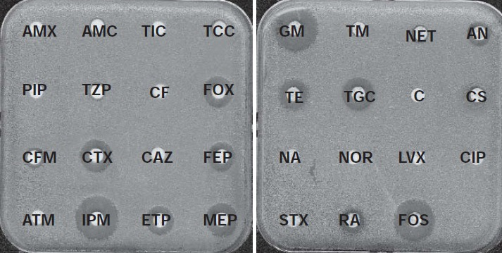
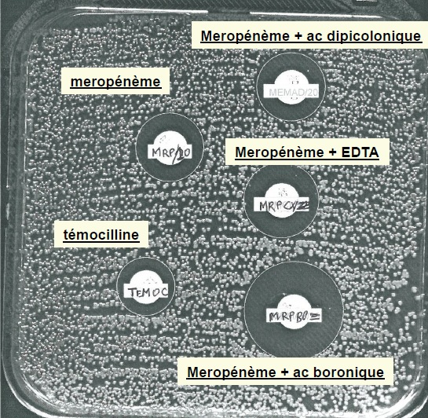

# Cas 1.125

Quelle carbapénémase ?

#### CORRIGÉ SUGGÉRÉ · CAS 1.125

*Proposition de réponse rédigée par l’auteur (le sujet ne comportait pas de corrigé type dactylographié).*

**1.** **Carbapénémase de classe A de type KPC.**

- Test d’inhibition : le méropénème seul ne donne **aucune zone** ; avec l’**acide boronique**, une **large zone** apparaît. L’acide boronique inhibe les sérine-β-lactamases de classe A (KPC).
- Acide dipicolinique et EDTA (chélateurs du zinc) : **pas de restauration** ⇒ pas de métallo-β-lactamase (classe B).
- Témocilline : aucune zone (R), compatible avec KPC comme avec OXA-48, donc non discriminante ; l’absence d’inhibition par les chélateurs et l’effet de l’acide boronique suffisent.
- Antibiogramme : pénicillines, associations, C3G, **aztréonam** et carbapénèmes inactifs, ce qui concorde avec KPC. Une métallo-β-lactamase épargnerait l’aztréonam.
- Confirmation : test immunochromatographique, PCR *bla*KPC. Souche à risque épidémique (BHRe) : précautions complémentaires et signalement.
