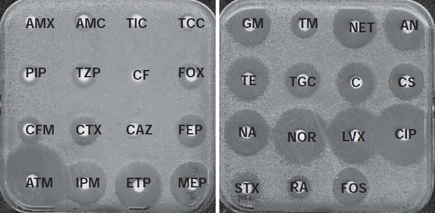
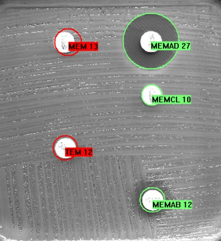

# Cas 1.126

Phénotypes ?

#### CORRIGÉ SUGGÉRÉ · CAS 1.126

*Proposition de réponse rédigée par l’auteur (le sujet ne comportait pas de corrigé type dactylographié).*

**1.** **Carbapénémase de classe B : métallo-β-lactamase** (type VIM, IMP ou NDM).

- Antibiogramme : pénicillines, associations, C1G, céfoxitine, C3G et céfépime sans zone ou avec zone très réduite ; **aztréonam conservé** (grande zone). Aminosides et autres familles S.
- Test d’inhibition (diamètres affichés) : méropénème seul **13 mm** ; avec **acide dipicolinique** (MEMAD) **27 mm**, soit un gain de 14 mm : l’inhibition par un chélateur du zinc signe une **métallo-β-lactamase**.
- Cloxacilline (MEMCL, 10 mm) et acide boronique (MEMAB, 12 mm) : aucun gain, donc ni AmpC ni KPC.
- Témocilline (TEM, 12 mm) : R, compatible mais non discriminante.
- Les diamètres des carbapénèmes sur l’antibiogramme sont à mesurer et à comparer aux seuils du CASFM ; une MBL peut donner des zones limites.
- Souche à risque épidémique (BHRe) : précautions complémentaires, signalement.
