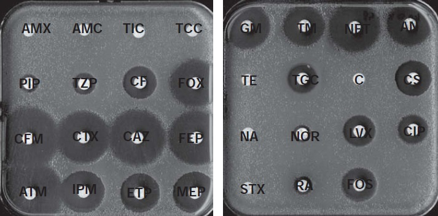

# Cas 1.127

Phénotypes ?

#### CORRIGÉ SUGGÉRÉ · CAS 1.127

*Proposition de réponse rédigée par l’auteur (le sujet ne comportait pas de corrigé type dactylographié).*

**1.** β-lactamines : **pénicillinase résistante aux inhibiteurs (TRI)** ou hyperproduction de pénicillinase.

- Amoxicilline, amoxicilline-acide clavulanique, ticarcilline et ticarcilline-clavulanate : **aucune zone**. Pipéracilline : aucune zone ; pipéracilline-tazobactam : zone réduite.
- Céfalotine : zone présente (conservée) ; céfoxitine, C3G, céfépime, aztréonam et carbapénèmes : zones larges.
- Pas de synergie : pas de BLSE ; céfoxitine S : pas de céphalosporinase hyperproduite.

**2.** Autres familles : **résistances associées**.

- **Tétracycline R, chloramphénicol R, cotrimoxazole R.**
- **Acide nalidixique et norfloxacine R**, avec lévofloxacine et ciprofloxacine à zones réduites : résistance de haut niveau aux quinolones (mutation de *gyr*A).
- Aminosides, tigécycline, colistine, rifampicine et fosfomycine : zones présentes (S).
