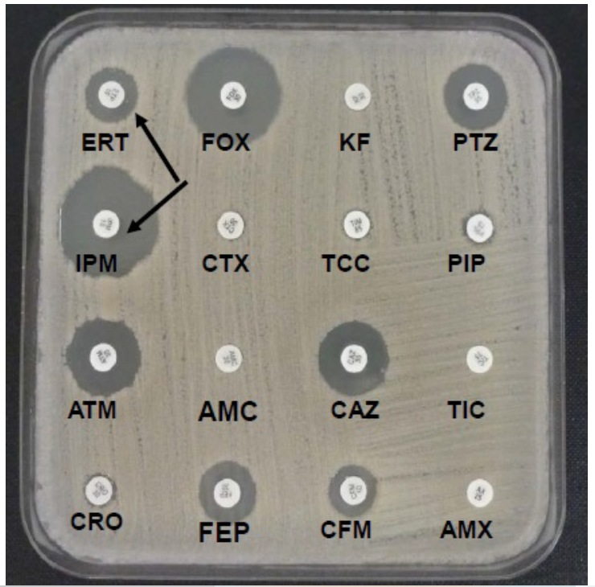

# Cas 1.128

#### CORRIGÉ SUGGÉRÉ · CAS 1.128

*Proposition de réponse rédigée par l’auteur (le sujet ne comportait pas de corrigé type dactylographié).*

**1.** **BLSE de type CTX-M** avec **sensibilité diminuée à l’ertapénème**, imipénème conservé.

- Pénicillines, associations (amoxicilline-acide clavulanique : aucune zone), céfalotine (KF) : R.
- **Céfoxitine (FOX) S** : pas de céphalosporinase hyperproduite.
- **Céfotaxime et ceftriaxone : aucune zone** ; céfixime, ceftazidime, céfépime et aztréonam : zones réduites. Un spectre qui touche surtout le céfotaxime et la ceftriaxone est celui des **CTX-M**.
- **Flèches** : zone de l’**ertapénème nettement plus petite que celle de l’imipénème**.
- Deux hypothèses : **imperméabilité** (perte de porines) associée à une BLSE, ou **carbapénémase de type OXA-48** (imipénème conservé, ertapénème touché).
- Tests complémentaires : **témocilline** (R en cas d’OXA-48), CMI des carbapénèmes, test immunochromatographique ou Carba NP, PCR.
