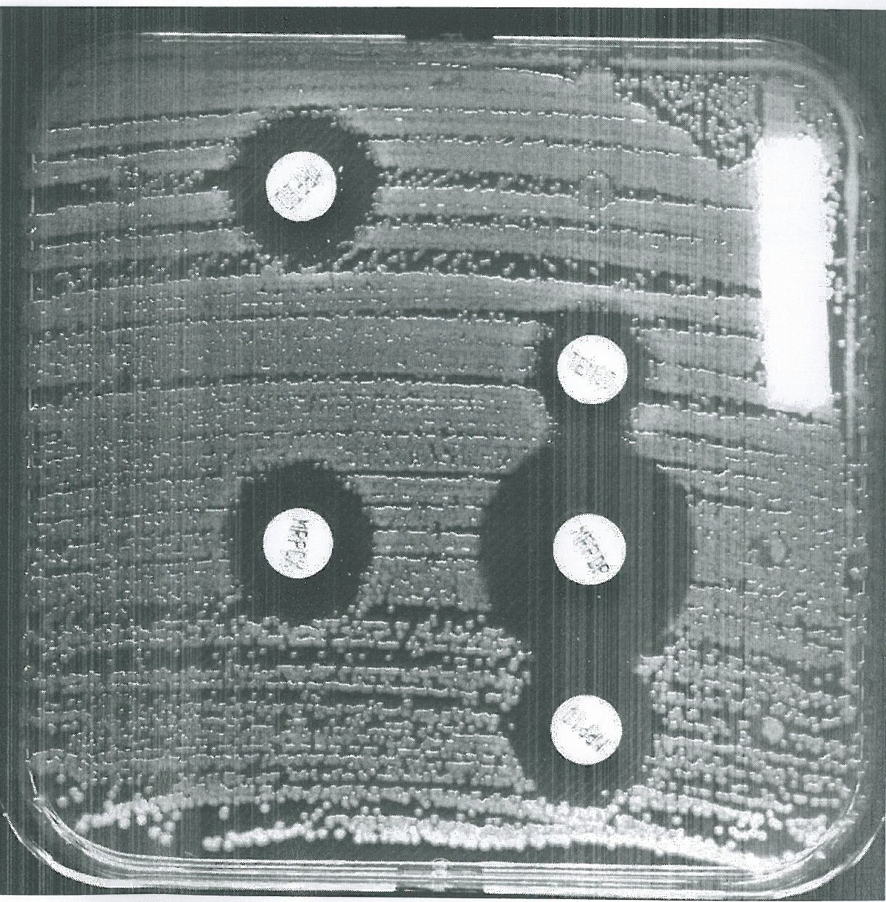

# Cas 1.129

Que pensez-vous de cet antibiogramme de *Klebsiella pneumoniae* isolé chez un patient hospitalisé pour une pneumopathie communautaire ?

| Antibiotique | Résultat |
|---|---|
| Amoxicilline | R |
| Amoxicilline + acide clavulanique | I |
| Ticarcilline | R |
| Ticarcilline + acide clavulanique | I |
| Pipéracilline | S |
| Pipéracilline + tazobactam | S |
| Céfalotine | I |
| Céfoxitine | S |
| Ceftazidime | S |
| Céfotaxime | S |
| Imipénème | S |

1. Possible
2. Pas possible

Après 15 J de ventilation le patient refait de la fièvre et on isole dans le LBA :

| Antibiotique | Résultat |
|---|---|
| Ampicilline | R |
| Amoxicilline/Ac. clavulanique | R |
| Ticarcilline | R |
| Ticarcilline/Ac. clavulanique | R |
| Pipéracilline | R |
| Pipéracilline/Tazobactam | R |
| Céfalotine | R |
| Céfoxitime | R |
| Céfixime | R |
| Ceftazidime | R |
| Ceftriaxone | R |
| Imipénème | I |
| Amikacine | R |
| Tobramycine | R |
| Gentamicine | R |
| Ac. nalidixique | R |
| Norfloxacine | R |
| Ofloxacine | R |
| Ciprofloxacine | R |
| Fosfomycine | S |
| Nitrofurantoïne | R |
| Cotrimoxazole | R |
| Colistine | S |

Il s’agit :

1. Pénicillinase large spectre
2. Pénicillinase TRI
3. BLSE
4. Carbapénémase
5. Céphalosporinase (ampC)
6. Je fais un test complémentaire

Même cas précédent, quelle conclusion ?

#### CORRIGÉ SUGGÉRÉ · CAS 1.129

*Proposition de réponse rédigée par l’auteur (le sujet ne comportait pas de corrigé type dactylographié).*

**1.** Antibiogramme de la pneumopathie communautaire : réponse **1, possible**.

- Amoxicilline R et ticarcilline R, associations avec inhibiteurs I, céfalotine I, pipéracilline, céfoxitine, C3G et imipénème S : c’est le **phénotype sauvage de *K. pneumoniae*** (pénicillinase chromosomique SHV-1 de bas niveau).

**2.** Souche du LBA après 15 jours de ventilation : réponse **4, carbapénémase** (probable), à confirmer par un test complémentaire (réponse 6).

- Résistance à **toutes les β-lactamines**, y compris **céfoxitine** et **pipéracilline-tazobactam**, avec **imipénème I**.
- Une BLSE épargne la céfoxitine et le tazobactam ; une céphalosporinase n’explique pas la résistance à l’imipénème.
- Profil de **multirésistance** : aminosides, quinolones, nitrofurantoïne et cotrimoxazole R ; **fosfomycine et colistine S**.
- Acquisition **nosocomiale** (patient ventilé) : souche différente de la souche communautaire initiale.

**3.** Conclusion de la plaque : **souche productrice de carbapénémase**, probablement de classe A (**KPC**) d’après le profil (céfoxitine R, tazobactam R, imipénème I).

- Les disques de la plaque ne sont pas étiquetés : l’identification exacte de l’enzyme repose sur les tests d’inhibition (acide boronique, EDTA ou acide dipicolinique), le test immunochromatographique ou la PCR.
- Conduite : **BHRe**, précautions complémentaires, signalement, dépistage des contacts ; options thérapeutiques réduites (fosfomycine, colistine, associations, nouvelles β-lactamines + inhibiteurs selon l’enzyme).
