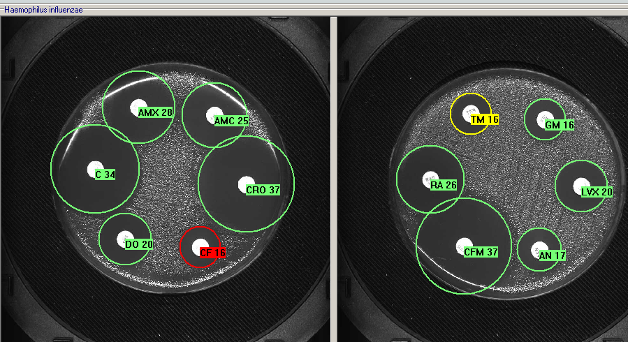

# Cas 1.130

*Haemophilus influenzae*, quel phénotype ?

- Modification de la cible
- Imperméabilité
- Production de β-lactamase

#### CORRIGÉ SUGGÉRÉ · CAS 1.130

*Proposition de réponse rédigée par l’auteur (le sujet ne comportait pas de corrigé type dactylographié).*

**1.** **Modification de la cible** (altération de la PLP3), souche **BLNAR** de bas niveau.

- Amoxicilline (28 mm), amoxicilline-acide clavulanique (25 mm), C3G (ceftriaxone 37 mm, céfixime 37 mm) : **sensibles**.
- **Céfalexine (CF, 15 mm, signalée R en rouge)** : résistance de la céphalosporine de 1^re^ génération, marqueur de l’altération de la PLP3.
- Une **β-lactamase** donnerait une amoxicilline R, restaurée par l’acide clavulanique, avec C1G/C2G S ; ce n’est pas le cas.
- Une **imperméabilité** réduirait aussi les zones des C3G, qui sont ici larges.
