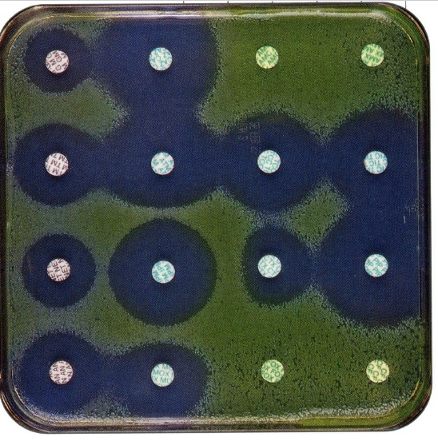

# Cas 1.131

*Pseudomonas aeruginosa*

Quel phénotype ?

#### CORRIGÉ SUGGÉRÉ · CAS 1.131

*Proposition de réponse rédigée par l’auteur (le sujet ne comportait pas de corrigé type dactylographié).*

Les disques ne sont pas étiquetés : l’identification d’un phénotype précis n’est pas possible sur la seule photographie.

**1.** Éléments observables et démarche de lecture.

- Plusieurs disques **sans aucune zone** (3^e^ et 4^e^ colonnes des lignes 1 et 4) ; les autres disques ont des zones nettes, certaines confluentes.
- Démarche : identifier chaque disque (ticarcilline ± clavulanate, pipéracilline ± tazobactam, ceftazidime, céfépime, aztréonam, imipénème, méropénème), puis comparer.
    - Ticarcilline R **restaurée** par le clavulanate : **pénicillinase**.
    - Toutes les β-lactamines I/R, **carbapénèmes S** : **efflux** (MexAB-OprM).
    - Ceftazidime et céfépime touchés, ticarcilline-clavulanate non restaurée : **céphalosporinase hyperproduite**.
    - **Imipénème R seul** : perte d’**OprD**.
    - **Imipénème et méropénème R, aztréonam S** : **métallo-β-lactamase**.
- Le phénotype ne peut être arrêté qu’après identification des disques.
