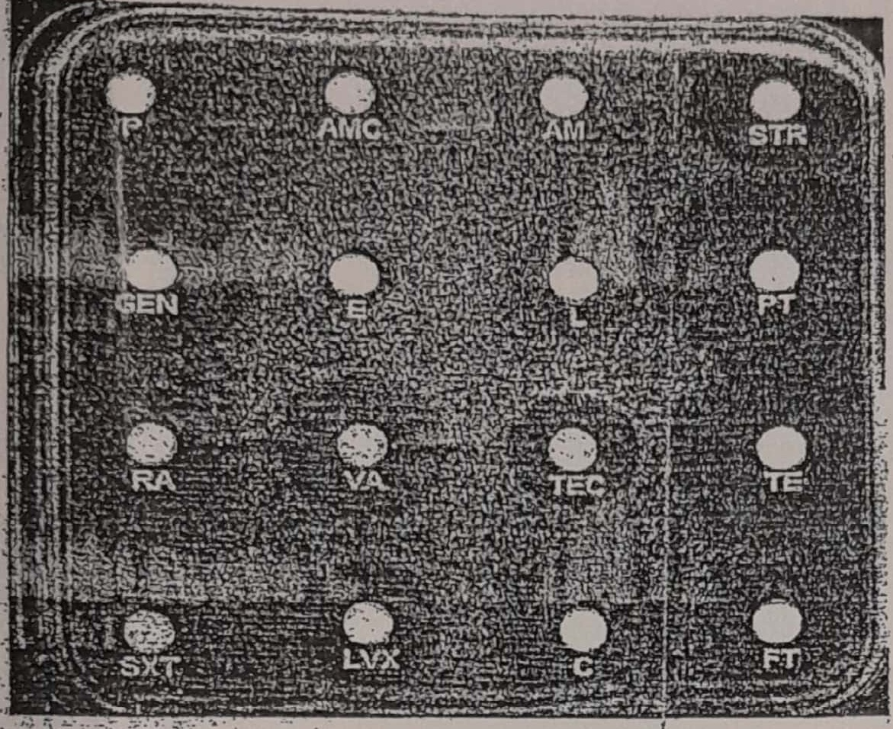

# Cas 1.132

*Enterococcus faecium* :

#### CORRIGÉ · CAS 1.132

*Corrigé type issu du document d’examen, reproduit tel quel.*

**3-** Il s’agit d’une souche d’*Enterococcus faecium* montrant une résistance acquise de haut niveau aux β-lactamines par hyperproduction de la PLP5, de faible affinité pour les pénicillines. Par ailleurs, elle montre une résistance vis-à-vis des macrolides et apparentés de type MLS~B~, ainsi qu’une résistance à la rifampicine (RA) et à l’association triméthoprime-sulfaméthoxazole (SXT). A noter la mauvaise activité des furanes (FT) sur cette espèce bactérienne.
