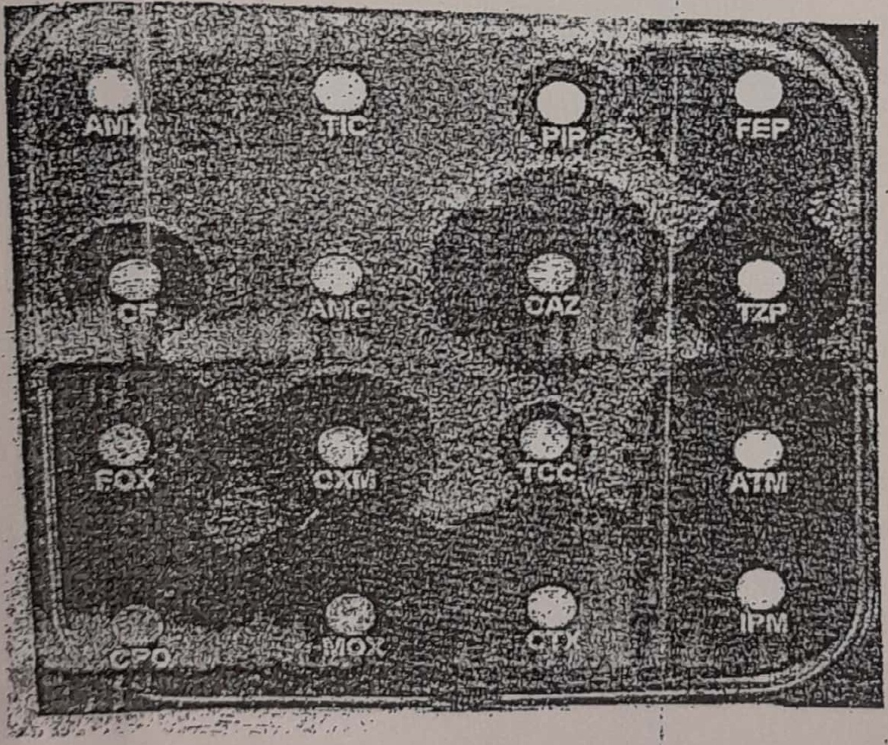

# Cas 1.133

*Escherichia coli* :

#### CORRIGÉ · CAS 1.133

*Corrigé type issu du document d’examen, reproduit tel quel.*

**4-** Vis-à-vis des β-lactamines, la souche montre un phénotype producteur d’une pénicillinase résistante aux inhibiteurs (IRT ou TRI). Noter la faible synergie entre l’amoxicilline (AMX) et son association avec l’acide clavulanique (AMC). Pour les autres antibiotiques, la souche est sensible aux aminoglycosides mais résistante aux quinolones classiques comme l’acide nalidixique (NA) avec une sensibilité diminuée vis-à-vis de la péfloxacine (PEF). On notera la résistance vis-à-vis du triméthoprime (TMP), des sulfamides (SXT), des tétracyclines (TE), du chloramphénicol (C) et enfin des nitrofuranes (FT).
