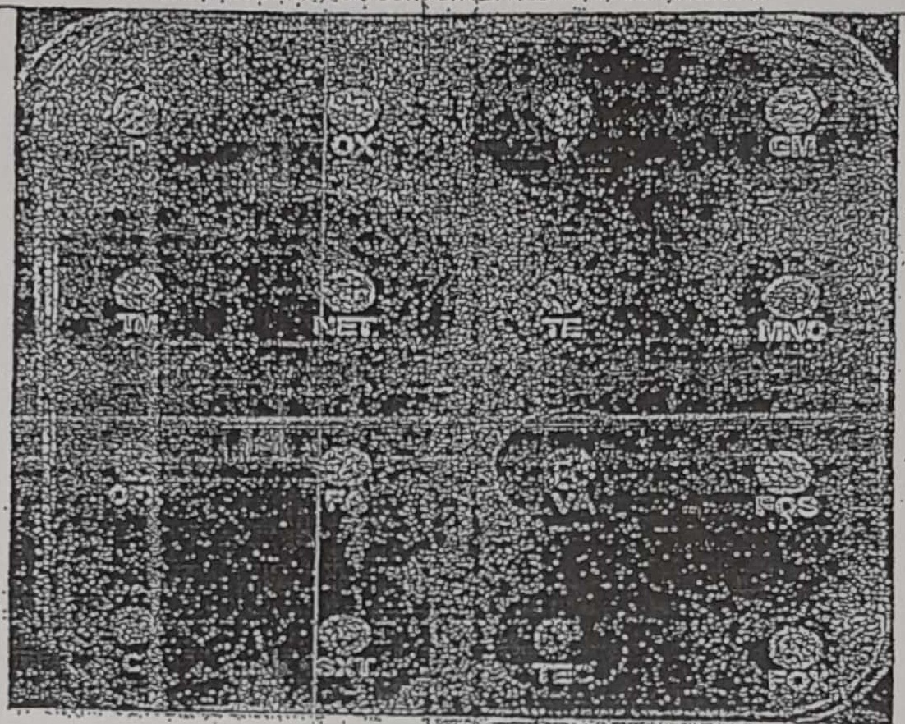
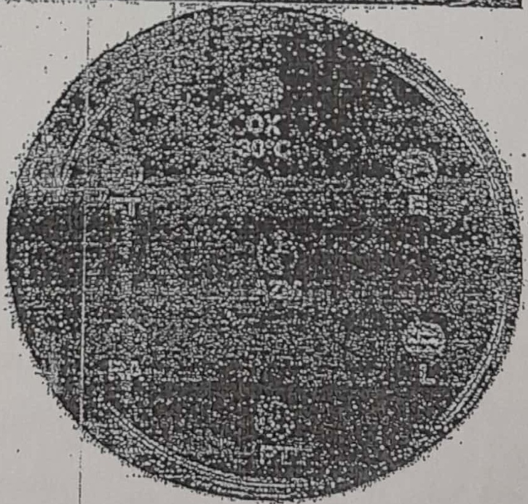

# Cas 1.134

ATB01 : Cette souche de *Staphylococcus aureus* a été isolée à partir de prélèvements systématiques de narine, réalisés lors de l’entrée à l’hôpital du malade dans un service de soins intensifs.

#### CORRIGÉ SUGGÉRÉ · CAS 1.134

*Proposition de réponse rédigée par l’auteur (le sujet ne comportait pas de corrigé type dactylographié).*

**Interprétation de l’antibiogramme.** Les diamètres ne sont pas lisibles sur la copie : la réponse suit la démarche de lecture attendue (CASFM/EUCAST).

- **Bêta-lactamines** : lire l’**oxacilline** (disque à 30 °C) et la **céfoxitine** ; une zone inférieure aux seuils signe un **SARM** (PLP2a, gène *mecA*), à confirmer par recherche de PLP2a ou de *mecA*.
- **Aminosides** : comparer kanamycine, tobramycine, nétilmicine et gentamicine ; résistance à KTG ⇒ enzyme bifonctionnelle AAC(6’)-APH(2’’), résistance à KT seule ⇒ ANT(4’).
- **Macrolides et apparentés** : érythromycine et lincomycine côte à côte ; zone aplatie (« en D ») ⇒ phénotype MLS~B~ inductible.
- **Tétracyclines** : une résistance homogène à tout le groupe, minocycline comprise, oriente vers un mécanisme d’efflux ou d’imperméabilité, alors qu’une résistance sélective à la tétracycline fait penser à *tet*(K).
- **Autres molécules** : fluoroquinolones, fosfomycine, rifampicine, acide fusidique, glycopeptides, cotrimoxazole.

**Intérêt du contexte.** Portage nasal à l’entrée en soins intensifs : si la souche est un SARM, appliquer les **précautions complémentaires contact** et envisager une décolonisation.
