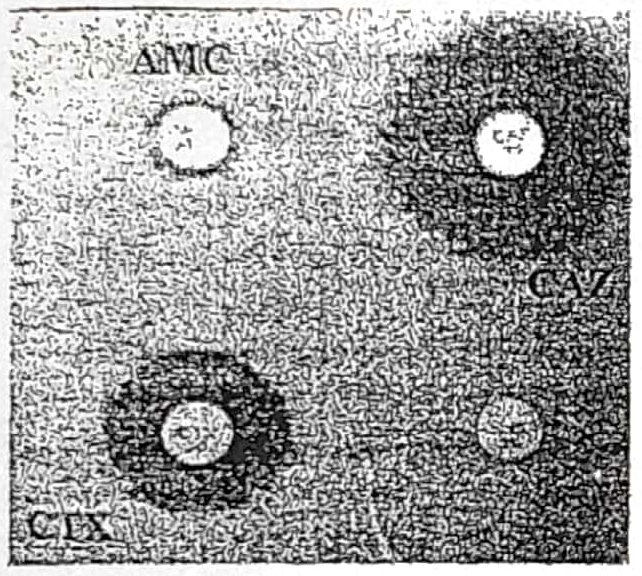

# Cas 1.136

SOURCE : *Université d’Alger, Faculté de Médecine, D.E.M.S. de Microbiologie — Session janvier 2020, Exercice n°1*

Voici une partie de l’antibiogramme d’une souche de *Proteus mirabilis*.

1. Quel(s) mécanisme(s) de résistance vous évoque cette image ?
2. Quel(s) test(s) complémentaire(s) phénotypique(s) proposez-vous pour confirmer ?

#### CORRIGÉ · CAS 1.136

*Corrigé type issu du document d’examen, reproduit tel quel.*

**1.** Céphalosporinase plasmidique

**2.** tester Céfépime et faire antibiogramme sur cloxa 250 mg/l
