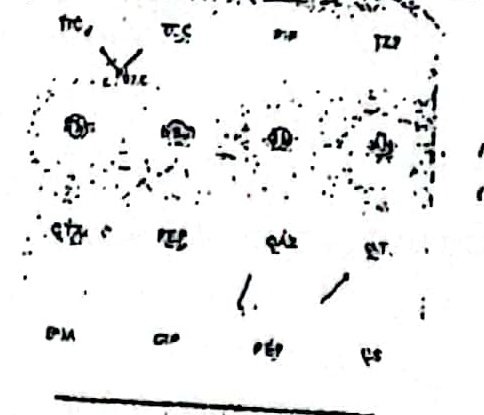

# Cas 1.164

SOURCE : *Phénotypes de Résistance aux Antibiotiques — Énoncé « Traiter les phénotypes suivants », Pr Kassah*

#### CORRIGÉ SUGGÉRÉ · CAS 1.164

*Proposition de réponse rédigée par l’auteur (le sujet ne comportait pas de corrigé type dactylographié).*

**1.** Image **illisible** sur la copie : les disques et les diamètres ne peuvent pas être interprétés.

- Démarche à suivre : lire les β-lactamines (ticarcilline ± acide clavulanique, pipéracilline ± tazobactam, ceftazidime, céfépime, aztréonam, imipénème), rechercher une **synergie** entre disques, puis conclure sur le phénotype (efflux, céphalosporinase, BLSE, carbapénémase).
- Voir « À vérifier ».
