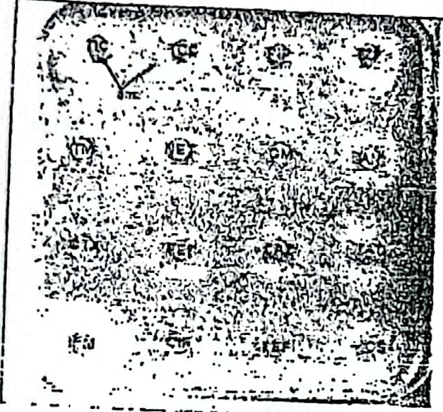

# Cas 1.165

SOURCE : *Phénotypes de Résistance aux Antibiotiques — Énoncé « Traiter les phénotypes suivants », Pr Kassah*

CMI AT (aztréonam) < CMI CAZ (ceftazidime)

#### CORRIGÉ SUGGÉRÉ · CAS 1.165

*Proposition de réponse rédigée par l’auteur (le sujet ne comportait pas de corrigé type dactylographié).*

**Interprétation** (lecture de la plaque limitée par la qualité de l’image).

- Une CMI de l’**aztréonam inférieure à celle de la ceftazidime** est caractéristique d’une **métallo-β-lactamase** (classe B) : l’aztréonam n’est pas hydrolysé par ces enzymes alors que la ceftazidime l’est.
- Confirmer par le test de **synergie avec un chélateur du zinc** (EDTA ou acide dipicolinique) et par la recherche moléculaire (VIM, IMP, NDM).
- Si une carbapénémase est confirmée : précautions complémentaires et signalement.
