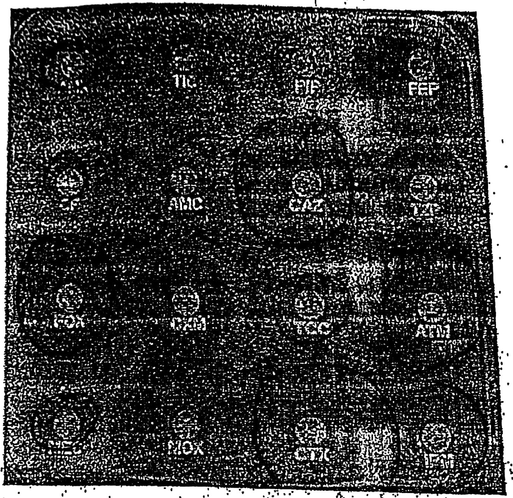
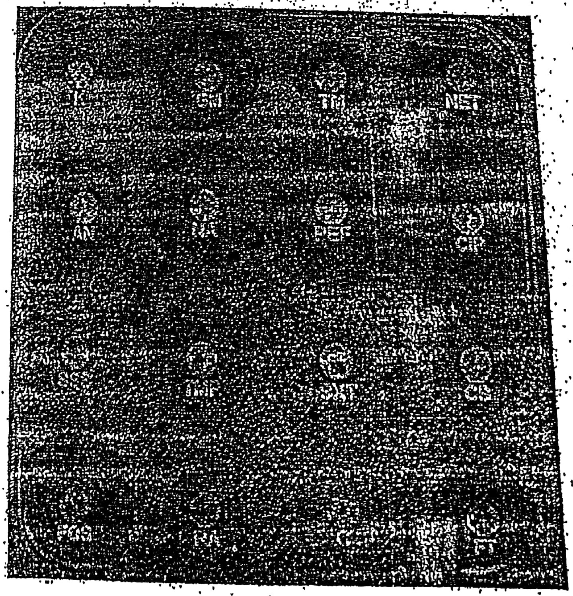

# Cas 1.81

Cette souche d’*Escherichia coli* a été isolée à partir d’un ECBU chez une patiente présentant un tableau de pyélonéphrite. Les hémocultures en aérobiose et en anaérobiose étaient également positives avec le même germe.

- Quel est le mécanisme de résistance aux β-lactamines évoqué ?
- Quel est le comportement de cette souche vis-à-vis des autres antibiotiques étudiés ?

#### CORRIGÉ SUGGÉRÉ · CAS 1.81

*Proposition de réponse rédigée par l’auteur (le sujet ne comportait pas de corrigé type dactylographié).*

**1.** Mécanisme évoqué : **pénicillinase de haut niveau** (type TEM-1 hyperproduite).

- Résistance à l’amoxicilline, à la ticarcilline et à la pipéracilline, avec zones d’inhibition très réduites autour de la céfalotine et de l’amoxicilline-acide clavulanique.
- Les inhibiteurs de β-lactamases ne rétablissent que partiellement l’activité : l’hyperproduction de l’enzyme dépasse leur capacité d’inhibition.
- Ce profil n’est ni celui d’une BLSE (pas de résistance aux C3G, pas d’image de synergie) ni celui d’une céphalosporinase de haut niveau (céfoxitine sensible).

**2.** Comportement vis-à-vis des autres antibiotiques.

- Pipéracilline-tazobactam, céfoxitine, ceftazidime, céfotaxime, céfépime, aztréonam et imipénème : **grandes zones d’inhibition**, donc sensibles.
- Aminosides, quinolones, cotrimoxazole, fosfomycine et nitrofuranes : lire les zones de la seconde gélose et rechercher une résistance associée.
