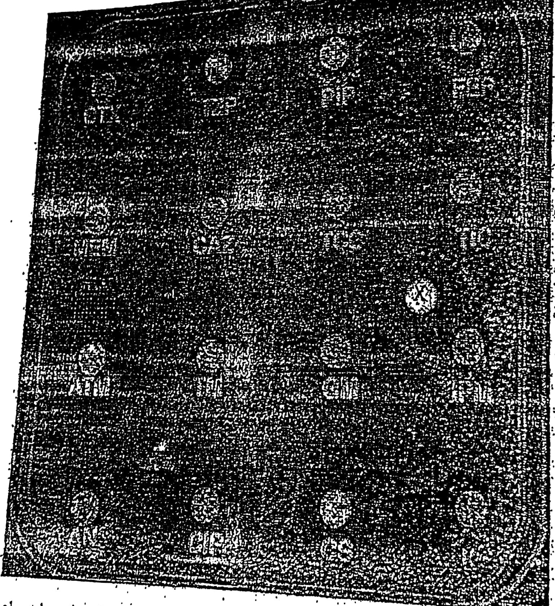

# Cas 1.82

Souche de *Pseudomonas aeruginosa* colonisant la sonde urinaire d’un patient de soins intensifs.

- Quel est le mécanisme de résistance aux β-lactamines ?
- Indiquer la nature du disque « X » et quel est son rôle ?

#### CORRIGÉ SUGGÉRÉ · CAS 1.82

*Proposition de réponse rédigée par l’auteur (le sujet ne comportait pas de corrigé type dactylographié).*

**1.** Mécanisme : **carbapénémase de classe B (métallo-β-lactamase)**.

- Résistance aux carbapénèmes (imipénème, méropénème) associée à la résistance aux pénicillines anti-pyocyaniques, à la ceftazidime et au céfépime.
- La métallo-β-lactamase (VIM, IMP, NDM) hydrolyse toutes les β-lactamines sauf l’aztréonam ; elle n’est inhibée ni par l’acide clavulanique ni par le tazobactam.
- Souche à risque épidémique : précautions complémentaires et signalement.

**2.** Disque « X » : **disque vierge imprégné d’EDTA** (ou d’acide mercaptopropionique).

- L’EDTA est un **chélateur du zinc**, cofacteur indispensable des métallo-enzymes.
- Une **synergie en « bouchon de champagne »** entre ce disque et la ceftazidime ou l’imipénème confirme la métallo-β-lactamase.
