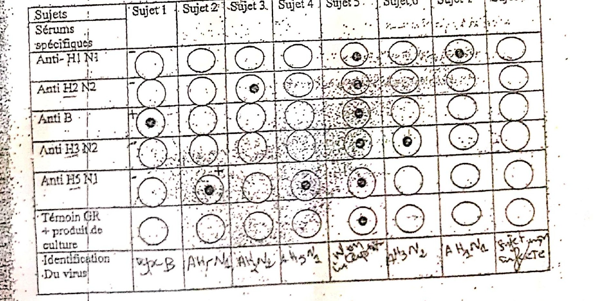

# Cas 3.4

SOURCE : *Dr Bencherif L. B., Laboratoire central — CHU de Sétif ; année universitaire 2008-2009 ; cas cliniques de virologie*

Dans le but d’identifier le virus grippal circulant durant l’année 2009, des prélèvements bronchiques ont été réalisés chez 8 sujets présentant un syndrome grippal.

La culture a été réalisée sur œuf de poule embryonné ; l’identification du produit de culture a été réalisée par test d’inhibition d’hémagglutination.

Interprétez ces résultats.

#### CORRIGÉ SUGGÉRÉ · CAS 3.4

*Proposition de réponse rédigée par l’auteur (le sujet ne comportait pas de corrigé type dactylographié).*

Principe : virus + globules rouges (GR) = **hémagglutination** ; virus + sérum spécifique homologue + GR = **inhibition de l’hémagglutination** (bouton de GR au fond du puits).

- **Sujet 1** : inhibition par le sérum anti-B : virus **grippal B**.
- **Sujet 2** : inhibition par l’anti-H5N1 : **A(H5N1)**.
- **Sujet 3** : inhibition par l’anti-H2N2 : **A(H2N2)**.
- **Sujet 4** : inhibition par l’anti-H5N1 : **A(H5N1)**.
- **Sujet 5** : tous les puits, y compris le témoin, sans hémagglutination : culture sans virus hémagglutinant, **résultat non concluant**.
- **Sujet 6** : inhibition par l’anti-H3N2 : **A(H3N2)**.
- **Sujet 7** : inhibition par l’anti-H1N1 : **A(H1N1)**.
- **Sujet 8** : hémagglutination non inhibitée par aucun des sérums : virus non identifié par ces sérums (autre sous-type ou autre agent hémagglutinant).
