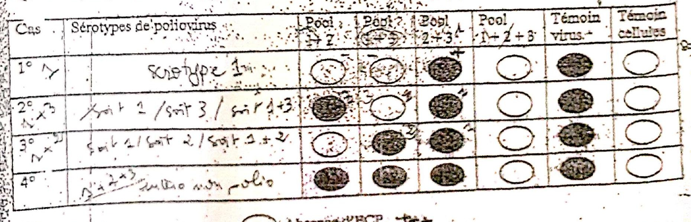

# Cas 4.1

SOURCE : *Dr Bencherif L. B., Laboratoire central — CHU de Sétif ; année universitaire 2008-2009 ; cas cliniques de virologie*

La culture cellulaire de prélèvements de selles chez 4 malades présentant des paralysies a permis d’obtenir des ECP à type d’arrondissement cellulaire avec refoulement du noyau en faveur d’une infection à poliovirus.

Dans le but de détermination les sérotypes de poliovirus isolés on a réalisé une neutralisation de l’ECP en culture par des pools de sérums anti-poliovirus.

Quel est (sont) le(s) sérotype(s) de poliovirus responsable(s) de l’infection dans chaque cas :

| Cas | Pool 1 + 2 | Pool 1 + 3 | Pool 2 + 3 | Pool 1 + 2 + 3 | Témoin virus | Témoin cellules |
|---|---|---|---|---|---|---|
| 1 | Absence d’ECP | Absence d’ECP | ECP (+) | Absence d’ECP | ECP (+) | Absence d’ECP |
| 2 | ECP (+) | Absence d’ECP | ECP (+) | Absence d’ECP | ECP (+) | Absence d’ECP |
| 3 | Absence d’ECP | ECP (+) | ECP (+) | Absence d’ECP | ECP (+) | Absence d’ECP |
| 4 | ECP (+) | ECP (+) | ECP (+) | Absence d’ECP | ECP (+) | Absence d’ECP |

#### CORRIGÉ SUGGÉRÉ · CAS 4.1

*Proposition de réponse rédigée par l’auteur (le sujet ne comportait pas de corrigé type dactylographié).*

Principe : un pool de sérums neutralise (**absence d’ECP**) les sérotypes qu’il contient ; l’ECP persiste si le sérotype est absent du pool.

**1.** Cas 1 : **sérotype 1** (neutralisé par les pools 1 + 2 et 1 + 3, pas par 2 + 3).

**2.** Cas 2 : **mélange des sérotypes 1 et 3** (seul le pool 1 + 3 neutralise les deux ; chacun des autres pools en laisse un).

**3.** Cas 3 : **mélange des sérotypes 1 et 2** (seul le pool 1 + 2 les neutralise tous les deux).

**4.** Cas 4 : **mélange des trois sérotypes (1, 2 et 3)**, neutralisé seulement par le pool 1 + 2 + 3.

Les témoins valident l’essai : témoin virus avec ECP, témoin cellules sans ECP.
