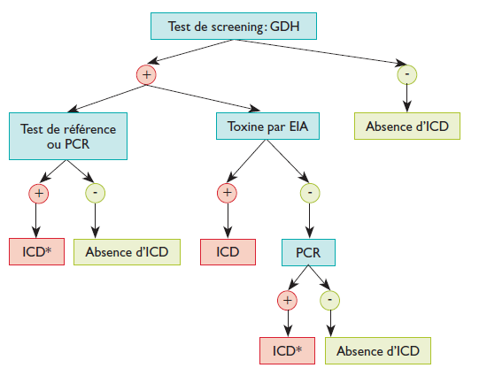

# Cas 15.10

SOURCE : *Examen intercalaire R3 Microbiologie — 20 juillet 2025, Constantine*

Diarrhée post-antibiotique à *Clostridium difficile* :

1. Facteurs de virulence.
2. Physiopathologie.
3. Diagnostic au laboratoire : Techniques et démarche diagnostique

#### CORRIGÉ · CAS 15.10

*Corrigé type issu du document d’examen, reproduit tel quel.*

**1. Introduction :**

- 1^re^ cause des DPA.
- BGP, anaérobie strict, sporulé, on le trouve dans l’eau, le sol et l’intestin de l’homme.
- Souches toxinogènes : toxines A, B et binaire = DPA.
- Complication : colite pseudomembraneuse.
- Diagnostic microbiologique oriente la PEC.
- Prophylaxie = Usage rationnel des antibiotiques.

**2. Facteurs de virulence :**

- **Entérotoxine A** : Protéine thermolabile codée par le gène *tcdA*.
- **Cytotoxine B** : action synergique avec l’entérotoxine A. Elle est codée par le gène *tcdB*.
- **Toxine binaire** : Produite par 20% souches toxinogènes. Elle est caractéristique du clone O27.

Seules les **souches toxinogènes** sont pathogènes.

**3. Physiopathologie :**

- Exposition à un traitement antibiotique (AMC, céphalosporines, clinda) induit la rupture de la diversité commensale de la flore intestinale.
- Diminution de la résistance à la colonisation par *C. difficile*, multiplication de ce dernier et production des toxines :
    - **Entérotoxine A** détruit la cytosquelette en induisant une apoptose de la muqueuse intestinale (d’où la formation de pseudomembrane). Elle a aussi une action sécrétoire en augmentant la perméabilité et la sécrétion du chlore.
    - **Cytotoxine B** a un effet synergique avec la toxine A. Elle est 1000 fois plus cytotoxique que la toxine A.
    - **Toxine binaire** : Rôle pas encore totalement élucidé, elle potentialise les effets des toxines A et B. Elle est associée à des infections plus sévères et à un taux de mortalité plus élevé.

**4. Diagnostic au laboratoire :**

**4.1 Techniques :**

**A. Techniques de référence :**

- **Culture toxigénique** : Technique longue (2-4 jours) et coûteuse.
    - **Etape 1. Culture et ID** : Les selles sont ensemencées sur milieu sélectif appelé CCFA ou le TCCA, incubées en atmosphère anaérobie pendant 48 heures. La bactérie est identifiée (galerie 20 A).
    - **Etape 2. Detremination du pouvoir toxinogène** : Le pouvoir toxinogène de la bactérie est alors recherché in vitro par un test de cytotoxicité, un test immuno enzymatique (toxines) ou par PCR (gènes des toxines).
- **Test de cytotoxicité** : Technique longue (1-2 jours) mais tres sensible et spécifique.
    - Inoculation d’un filtrat stérile de selles sur culture cellulaire (Vero, CHO, MRC5…) puis en l’observation de l’ECP détecté en 24 à 48 h. L’effet cytotoxique se manifeste par la dislocation du cytosquelette et la ballonisation cellulaire.

**B. Techniques immunologiques :**

+/- Rapides et sensibles.

- Immunoenzymatiques : ELISA pour le MEE de la GDH et/ou les toxines A, B.

**PS.** Les Kits ELISA détectant que la GDH ont une excellente VPN mais peu spécifique (souche toxinogènes et non toxinogénes).

- Immunochromatographiques : pour le MEE de la GDH et/ou les toxines A, B.

**C. Techniques moléculaires :**

MEE des gènes *tcdA*, *tcdB*, *cdtA* et *cdtB* codant pour les toxines de *C. difficile*.

Technique rapide, sensible mais de mauvaise VPP : portage asymptomatique des souches toxinogène est possible.

**4.2 Démarche diagnostique :**

**5. Conclusion :**

Le rôle du microbiologiste dans le diagnostic d’une DPA à *C. difficile* reste prémordial. Vue la variété des tests disponibles.

Il veille à adopter un algorithme diagnostique qui soit rapide, simple, sensible et spécifique. Cet algorithme doit idéalement combiner plusieurs méthodes pour optimiser la fiabilité du diagnostic.
